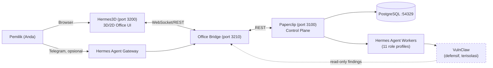

# ALLINONE-AGENT

**Unified Autonomous AI Company & Interactive 3D Virtual Office**

> Bahasa Indonesia (dokumen ini) · [English](README_EN.md)

---

## ⚠️ Status repositori ini

Repositori ini adalah hasil konsolidasi menyeluruh dari platform yang sebelumnya berjalan di satu komputer Windows pribadi, menjadi satu produk yang (secara bertahap) bisa diinstal ulang di komputer lain. **Setiap klaim di dokumen ini sudah diverifikasi ulang secara independen** — bukan disalin mentah dari laporan internal sebelumnya — dan beberapa klaim lama ternyata keliru atau sudah usang; semuanya dikoreksi di sini, bukan disembunyikan. Lihat [Known Limitations](#known-limitations-batasan-yang-diketahui) sebelum menggunakan ini untuk apa pun yang penting.

**Belum pernah dilakukan**: instalasi *end-to-end* penuh (`install.ps1` dari awal sampai 11 agent berjalan) di mesin mana pun, termasuk mesin referensi aslinya. Yang sudah benar-benar diverifikasi: setiap komponen individual berhasil di-*build*/dikompilasi/diimpor dari checkout bersih (lihat [Testing](#testing)).

---

## 1. Gambaran Produk

ALLINONE-AGENT bukan chatbot, bukan sekadar AI coding assistant, dan bukan satu agen tunggal. Ini adalah integrasi dari beberapa komponen nyata menjadi satu "kantor virtual" dengan organisasi AI beranggotakan 11 peran:

- **Hermes Agent** — *execution engine* yang menjalankan masing-masing agent, dengan gateway Telegram opsional.
- **Paperclip** — *control plane*: orkestrasi task, manajemen agent, governance, task queue.
- **VulnClaw** — integrasi keamanan **defensif saja** (analisis temuan, bukan tooling ofensif), terisolasi secara ketat.
- **Hermes3D** — kantor virtual 3D (Three.js/React Three Fiber) dan 2D (Phaser) yang menampilkan status 11 agent secara real-time.
- **Office Bridge** — jembatan WebSocket/REST yang menyinkronkan Paperclip, Hermes, dan tampilan kantor.

Bedanya dengan "AI coding assistant biasa": di sini ada organisasi dengan 11 peran (CEO, CTO, Backend/Frontend Developer, DevOps, QA, Security Lead/Reviewer, Findings Analyst, Remediation Reviewer, Compliance Reporter), masing-masing dengan identitas, izin, dan ruang kerja sendiri — bukan satu sesi chat generik.

## 2. Fitur Utama

| Fitur | Status |
|---|---|
| Orkestrasi task & agent (Paperclip) | **native** — upstream resmi, pinned version, tidak dimodifikasi |
| Kantor 3D (Hermes3D) | **custom** — hasil kustomisasi nyata (24 file diff dari upstream `iamlukethedev/Hermes3D`), berhasil *build* bersih |
| Kantor 2D (Phaser fallback) | **custom** — berbagi data state yang sama dengan mode 3D (dikonfirmasi secara struktural; belum dibuktikan identik saat runtime) |
| 11 role agent dengan Wave-1 (aktif)/Wave-2 (standby) | **native** — diverifikasi langsung dari kode provisioning (`org_provisioner.py`), sesuai klaim asli |
| Integrasi Telegram | **custom**, **opsional** — lihat [Known Limitations](#known-limitations-batasan-yang-diketahui) soal status rotasi kredensial |
| Integrasi VulnClaw (defensif) | **native**, terisolasi — lingkup tidak diperluas melampaui integrasi yang sudah ada |
| Office Bridge (realtime sync) | **custom**, **partial** — lihat catatan Node.js di bawah |
| Instalasi & setup wizard | **custom**, baru dibuat, **belum diuji end-to-end** (lihat Testing) |
| Unified CLI `ai-platform` | **native** — perintah nyata: `status health services agents tasks updates logs telegram-cmd emergency-stop resume-wave1 run-maintenance` |
| Maintenance harian (03:00 WIB, offline catch-up) | **custom**, kode asli (`hermes-autoupdate.ps1`, dll.) divendor apa adanya |

## 3. Arsitektur



Batas kepercayaan: VulnClaw hanya diakses **read-only** oleh Office Bridge untuk menampilkan temuan keamanan — tidak pernah sebaliknya. Semua endpoint pemilik (owner-only) memakai *fail-closed*: jika `ALLINONE_TELEGRAM_OWNER_ID` belum diset, endpoint mutasi menolak semua pemanggil (dibuktikan saat *smoke-test* di Phase 49, bukan cuma klaim desain).

## 4. System Requirements

Jujur apa adanya, bukan tabel spesifikasi minimum yang dikarang:

- **OS**: Windows 10 Pro 22H2 x64 (mesin referensi) atau Windows 11. Jika memakai Windows 10, pastikan edisi/build Anda masih menerima pembaruan keamanan dari Microsoft — installer tidak memverifikasi ini secara otomatis.
- **Node.js**: **>= 22.0.0** (keras, bukan rekomendasi). Office Bridge memakai `node:sqlite` (builtin Node 22.5+) untuk 3 adapter temuan VulnClaw/analytics; di Node 20 ketiganya gagal total saat dimuat — ini bug lama di platform asli, bukan sesuatu yang baru dibuat konsolidasi ini.
- **Git**, **Python 3.x** (hanya modul stdlib yang dipakai oleh `integration/`, tidak perlu `pip install` tambahan untuk CLI inti).
- **.NET SDK 8.0** — hanya diperlukan untuk mengompilasi ulang launcher Windows (`automation/launchers/*.csproj`); tidak wajib untuk menjalankan platform jika Anda tidak membangun ulang launcher.
- **RAM**: *tidak ada minimum keras yang diberlakukan.* Preflight installer hanya memberi peringatan informasional di bawah 8GB — proyek ini belum diuji di cukup banyak variasi hardware untuk mengklaim angka minimum universal. Mesin referensi aslinya adalah Pentium G5400 / 8GB RAM / GT 710 2GB — hardware kelas rendah, bukan workstation.
- **GPU**: mode 3D memakai WebGL (Three.js); mode 2D (Phaser) tersedia sebagai fallback untuk GPU rendah/absen.
- **Disk**: build Hermes3D sendiri memakan ~900MB (termasuk `node_modules`/`.next`, yang tidak ikut terdistribusi di repo ini dan dibangun ulang saat instalasi). Sediakan ruang bebas jauh lebih besar dari itu untuk dependency install + artifact build.
- **Jaringan**: diperlukan saat instalasi *Fresh* (git clone ke 3 upstream: Paperclip, VulnClaw, Hermes Agent bridge).

## 5. Quick Start

```powershell
git clone https://github.com/Vistapra/ALLINONE-AGENT.git
cd ALLINONE-AGENT
.\install.ps1 -DryRun
```

Jalankan dulu dengan `-DryRun` untuk melihat rencana instalasi tanpa perubahan apa pun. Setelah yakin:

```powershell
.\install.ps1
.\setup.ps1
.\start.ps1
.\health.ps1
```

Atau lewat batch wrapper (tidak perlu mengubah execution policy PowerShell sistem):

```text
install.cmd
```

**Catatan jujur**: `install.ps1` sudah divalidasi secara statis (parsing, logika per-stage, dan sebagian fungsi preflight-nya benar-benar dijalankan langsung terhadap mesin nyata saat Phase 45) tetapi **belum pernah dijalankan end-to-end** dari awal sampai akhir di mesin mana pun. Jalankan `-DryRun` dulu dan baca rencananya sebelum lanjut.

## 6. Instalasi — Mode

`install.ps1 -Mode <Auto|Fresh|Adopt|Repair|Dev>` (default `Auto`, mendeteksi sendiri):

- **Fresh** — komputer belum punya instalasi ALLINONE-AGENT/Hermes/Paperclip apa pun.
- **Adopt** — mendeteksi instalasi existing (Hermes home, scheduled task platform, `ALLINONE_HOME`) dan memakainya kembali tanpa menduplikasi service, database, atau scheduled task. Ini jalur paling realistis di komputer yang sudah pernah menjalankan platform.
- **Repair** — untuk memperbaiki dependency/konfigurasi tanpa menghapus data aktif.
- **Dev** — menyiapkan lingkungan pengembangan.

Instalasi bersifat *idempotent*: jalankan ulang tanpa `-Force` tidak akan menduplikasi apa pun yang sudah tercatat selesai di `runtime\install-state.json`.

## 7. Model Provider Setup

`setup.ps1` meminta provider, base URL, nama model, dan API key (disimpan lokal, tidak pernah ke repo ini). Contoh konfigurasi yang **tetap didukung tapi bukan satu-satunya pilihan dan bukan endorsement tervalidasi**: `provider: custom`, `model: combo/X`, dengan `CUSTOM_API_KEY` sebagai referensi credential. Anda bebas mengisi provider lain (OpenAI-compatible endpoint apa pun) selama base URL dan model name diisi dengan benar. **Verifikasi konektivitas provider secara live belum diimplementasikan** di `setup.ps1` saat ini — ditandai `[NOT VERIFIED]` di kode, bukan diklaim berfungsi.

## 8. Telegram Setup (opsional)

Lihat [TELEGRAM-SETUP.md](TELEGRAM-SETUP.md) untuk langkah lengkap: buat bot sendiri lewat @BotFather, cari numeric owner ID Anda, isi `config/telegram.example.yaml` → salinan lokal, jalankan gateway, uji satu perintah aman, uji bahwa akses tak sah ditolak. **Integrasi Telegram sepenuhnya opsional** — kantor 3D/2D berjalan tanpa bot apa pun.

Kantor virtual bisa dibuka tanpa Telegram sama sekali di:

```text
http://127.0.0.1:3200/office
```

## 9. Membuka Kantor Virtual

- **3D**: `http://127.0.0.1:3200/office` (default, perlu WebGL).
- **2D**: fallback Phaser untuk GPU rendah — toggle tersedia di UI yang sama.
- Login pakai kredensial owner yang dibuat `setup.ps1` (token lokal baru, **bukan** token instalasi lama mana pun).

## 10. Contoh Prompt

Pada workspace sintetis/terotorisasi:

- "CEO, susun rencana pengembangan fitur X untuk 2 minggu ke depan."
- "CEO, adakan rapat dengan Backend Developer dan QA Engineer soal rencana migrasi database."
- "Backend Developer, buatkan unit test untuk modul Y."
- "QA Engineer, verifikasi perubahan pada PR #123."
- "Security Reviewer, analisis temuan VulnClaw terbaru dan prioritaskan."
- "Semua agent, laporkan status pekerjaan masing-masing."

## 11. Commands Reference

Unified CLI nyata (diverifikasi langsung dari source `integration/platform_cli.py`, bukan disalin dari brief):

```text
ai-platform status [--json]
ai-platform health [--json]
ai-platform services [--json]
ai-platform agents [--json]
ai-platform tasks [--json]
ai-platform updates [--json]
ai-platform logs [--tail N]
ai-platform telegram-cmd <command> [--args ...] [--caller-id ...] [--message-id ...] [--notify]
ai-platform emergency-stop
ai-platform resume-wave1
ai-platform run-maintenance [--force] [--dry-run]
```

Perintah lifecycle: `start.ps1`, `stop.ps1`, `restart.ps1`, `health.ps1`, `update.ps1`, `uninstall.ps1` — lihat [INSTALLER-REFERENCE.md](INSTALLER-REFERENCE.md) untuk flag lengkap setiap skrip.

## 12. Service Management & Scheduled Tasks

Installer ini **hanya** mengelola 4 scheduled task: `PaperclipServer`, `OfficeVirtualCompany`, `PlatformHealthWatchdog`, `PlatformMaintenance`. Ada 4 task lain yang dimiliki paket `hermes-agent` upstream terpisah (`HermesAutoUpdate`, `Hermes_Gateway`, `HermesPostRebootVerify`, `cua-driver-serve`) — **installer ini tidak pernah menyentuhnya**, termasuk `uninstall.ps1` (diverifikasi langsung dari kode, bukan asumsi). Lihat [docs/SERVICE-MANAGEMENT.md](docs/SERVICE-MANAGEMENT.md).

## 13. Maintenance

Jadwal default 03:00 Asia/Jakarta, dengan offline catch-up dan active-task deferral — lihat [docs/MAINTENANCE.md](docs/MAINTENANCE.md). Timezone dan jadwal dapat dikonfigurasi.

## 14. Security & Privacy

- **Status rotasi kredensial pada instalasi referensi (apa adanya, bukan menutup-nutupi)**: token bot Telegram dan API key model pada instalasi asli **belum dirotasi** sejak sempat terekspos di riwayat chat (dikonfirmasi langsung dari dokumen audit keamanan platform itu sendiri). Instalasi baru dari repo ini **tidak pernah** menyalin/menggunakan kembali nilai-nilai itu — selalu membuat konfigurasi lokal baru dari template `.example`.
- Repositori ini sudah melalui **beberapa putaran audit keamanan nyata**, bukan satu kali *scan* otomatis lalu dianggap selesai. Contoh bug nyata yang ditemukan dan diperbaiki selama proses ini (tanpa menyebut nilai asli yang bocor):
  - Pemeriksaan otorisasi owner yang *fail-open* (ID kosong bisa cocok dengan ID pemanggil kosong) — sekarang *fail-closed*.
  - Teks placeholder mati yang tertinggal dari proses redaksi otomatis sebelumnya, yang secara diam-diam menonaktifkan daftar proteksi akses kredensial.
  - Path *default-trust* yang di-hardcode ke satu folder proyek privat tertentu — sekarang berbasis konfigurasi, *fail-closed*, opt-in.
  - Bug penamaan paket Python yang akan membuat CLI/health-check/maintenance coordinator *crash* saat pertama kali dipakai — sudah diperbaiki dan diverifikasi dengan benar-benar mengimpor seluruh modul.
  - Bug ekspansi variabel di skrip PowerShell yang diam-diam menonaktifkan pemanggilan *health-heal* pasca-update.
- **Satu alat *scan* rahasia otomatis terbukti tidak cukup**: `detect-secrets` (alat tepercaya dan umum dipakai) melewatkan kredensial nyata bertipe rendah-entropi saat diuji langsung ke folder yang berisi JWT secret/API key asli. Verifikasi manual tetap menjadi lapisan keamanan utama di proyek ini, bukan sekadar pelengkap.
- Aset 3D/HDRI bawaan Hermes3D di `apps/hermes3d/public/office-assets/` **tidak memiliki lisensi yang dinyatakan** — berkas biner tidak diikutkan ke repo ini (lihat README di lokasi tersebut); Anda perlu menyediakan aset Anda sendiri atau menunggu kejelasan lisensi.

## 15. Testing

**Yang benar-benar sudah diverifikasi** (Phase 49, build dari checkout bersih, bukan klaim):

| Komponen | Hasil | Bukti |
|---|---|---|
| Hermes3D (`npm install` + `tsc --noEmit` + `next build`) | **PASS** | 637 package terpasang bersih, 0 error TypeScript, build produksi sukses, 32 route dihasilkan |
| Python `integration/` | **PASS** | Seluruh modul berhasil diimpor dari checkout bersih |
| 3 launcher C# (`dotnet build`, .NET 8) | **PASS** | 0 error di ketiganya |
| Office Bridge | **PARTIAL** | `package.json` yang hilang sudah ditambahkan; *smoke-load* berhasil sampai titik bind port, tapi 3 adapter butuh Node 22+ (lihat System Requirements) |

**Belum diverifikasi** (dijadwalkan untuk fase pengujian berikutnya, belum dilakukan): instalasi *end-to-end* penuh, eksekusi 11 agent sungguhan, rapat multi-agent 3D/2D end-to-end, regresi fungsional lintas-metode, uji beban. Jangan menganggap fitur-fitur itu "sudah teruji" hanya karena source code-nya ada.

## 16. Troubleshooting

| Gejala | Kemungkinan penyebab |
|---|---|
| `office-bridge/server.js` gagal dimuat, error `node:sqlite` | Node < 22. Perbarui Node ke >= 22 (lihat System Requirements) — ini bukan bug baru dari repo ini. |
| Port sudah dipakai saat preflight | Wajar jika mode `Adopt` pada instalasi yang sudah berjalan; pilih port lain di konfigurasi lokal jika ini instalasi baru. |
| `ai-platform` CLI error `ModuleNotFoundError` | Pastikan dijalankan dari root repo atau `PYTHONPATH` mengarah ke sana — lihat catatan di `integration/`. |
| Endpoint owner-only menolak semua permintaan | Sesuai desain *fail-closed* — isi `ALLINONE_TELEGRAM_OWNER_ID` di konfigurasi lokal Anda. |
| `install.ps1` gagal di preflight Node | Preflight memang keras mensyaratkan Node >= 22.0.0 sejak keputusan ini dibuat — lihat System Requirements. |

## 17. Project Structure

```text
ALLINONE-AGENT/
  install.ps1 install.cmd setup.ps1 start.ps1 stop.ps1 restart.ps1 health.ps1 update.ps1 uninstall.ps1
  apps/            hermes3d/ (vendor penuh, custom) · office-bridge/ (custom, tanpa upstream)
  integration/      unified CLI Python (platform_cli, org_provisioner, workflow_engine, dll.)
  agents/roles/     11 definisi peran + template, identitas dibuat baru saat instalasi
  automation/       launcher C#, watchdog, scheduled-task registrar, updater, maintenance
  upstream/         components.lock.json + patch Hermes3D
  config/           template *.example.*
  scripts/lib/      modul PowerShell bersama (Preflight, InstallState)
  docs/             dokumentasi + arsip riwayat pengembangan (diredaksi)
  tests/            fixture sintetis, e2e, unit
```

Peta lengkap asal setiap berkas (dari lokasi aslinya di komputer referensi ke lokasi di repo ini) didokumentasikan secara internal selama proses konsolidasi; lihat [docs/UPSTREAM-COMPONENTS.md](docs/UPSTREAM-COMPONENTS.md) untuk ringkasan komponen upstream.

## 18. Development Guide

- Jalankan `.\install.ps1 -Mode Dev -DryRun` untuk melihat rencana setup pengembangan.
- Build Hermes3D: `cd apps\hermes3d && npm install && npm run typecheck && npm run build`.
- Build launcher C#: `dotnet build automation\launchers\<Nama>.csproj` (perlu .NET SDK 8).
- Tambah agent role baru: duplikasi `agents/roles/<role>/` lalu daftarkan di `integration/org_provisioner.py`.
- Jalankan test: lihat [docs/legacy-platform-docs](docs/legacy-platform-docs/) untuk arsip historis; suite pengujian aktif ada di `tests/`.

## 19. Upstream Credits

Lihat [THIRD-PARTY-NOTICES.md](THIRD-PARTY-NOTICES.md) untuk teks lisensi/copyright lengkap, disalin verbatim dari masing-masing proyek:

- **Hermes Agent** — jembatan npm oleh wyrtensi (MIT), memuat upstream resmi [NousResearch/hermes-agent](https://github.com/NousResearch/hermes-agent) (MIT).
- **Paperclip** — [paperclipai/paperclip](https://github.com/paperclipai/paperclip) (MIT), referensi pinned, tidak dimodifikasi.
- **VulnClaw** — [Netw0rkNoob/VulnClaw](https://github.com/Netw0rkNoob/VulnClaw) (MIT), dipakai murni sebagai integrasi defensif, lingkup tidak diperluas.
- **Hermes3D** — [iamlukethedev/Hermes3D](https://github.com/iamlukethedev/Hermes3D) (MIT), divendor penuh dengan modifikasi lokal (lihat `upstream/patches/`).

## 20. License

Keempat dependency upstream berlisensi MIT (diverifikasi dari berkas LISENSI asli masing-masing, bukan diasumsikan). **Kode custom milik repositori ini sendiri** (`apps/office-bridge/`, `integration/`, `agents/`, `automation/`, skrip installer) **belum memiliki berkas LICENSE sendiri** — ini keputusan yang perlu diambil pemilik repositori; mengingat seluruh dependency upstream bersifat MIT, lisensi MIT yang konsisten adalah rekomendasi yang wajar, tapi ini bukan keputusan yang diambil sepihak di sini.

## 21. Known Limitations (Batasan yang Diketahui)

Ditulis selengkap mungkin dengan sengaja — ini bagian paling penting untuk kepercayaan:

- Instalasi *end-to-end* penuh **belum pernah dijalankan** di mesin mana pun.
- Office Bridge tidak bisa dimuat di Node < 22 (lihat System Requirements) — ini bug platform asli, diwarisi, bukan baru.
- Aset 3D/HDRI Hermes3D tidak memiliki lisensi yang dinyatakan — tidak diikutkan ke repo ini.
- Lisensi kode custom repositori ini sendiri belum ditetapkan (lihat License di atas).
- Kesejajaran runtime penuh antara mode 3D dan 2D (bukan cuma kesamaan struktural kode) belum dibuktikan.
- Klaim "11 agent duduk bersama dalam satu rapat" — mekanisme dasarnya (pathfinding, delegasi task Paperclip) nyata, tapi bukti evidence rapat multi-agent yang benar-benar selesai dan terdokumentasi **belum ditemukan**; jangan menganggap ini sudah berfungsi penuh.
- Angka pengujian lama dari platform asli ("390/390 PASS") **kontradiktif dengan dirinya sendiri** di sumber aslinya (bagian lain dokumen yang sama menyebut "387 PASS, 3 NOT_TESTED") — jangan dipublikasikan ulang sebagai fakta tanpa rekonsiliasi lebih lanjut.
- `npm audit` pada Hermes3D melaporkan 24 kerentanan dependency (termasuk 2 kritis) — belum diperbaiki secara otomatis, perlu peninjauan sendiri sebelum produksi.
- Rotasi kredensial pada instalasi referensi asli belum dilakukan pemiliknya (lihat Security & Privacy) — ini bukan sesuatu yang bisa diperbaiki dari dalam repo ini.
- Verifikasi konektivitas provider model secara live belum diimplementasikan di `setup.ps1`.

## 22. Roadmap

- Pengujian instalasi *end-to-end* (Fresh/Adopt/Repair) di lingkungan terisolasi.
- Keputusan & implementasi perbaikan Office Bridge di Node < 22 jika diperlukan ke depannya.
- Kejelasan lisensi aset 3D Hermes3D.
- Penetapan lisensi kode custom repositori ini.
- CI/CD dan repository hygiene (lihat [.github/](.github/) jika sudah tersedia).

## 23. Support

Laporkan isu lewat GitHub Issues repositori ini. **Jangan pernah menyertakan token, API key, atau kredensial apa pun** di laporan isu — lihat [SECURITY.md](SECURITY.md) untuk cara melaporkan temuan keamanan secara privat.
