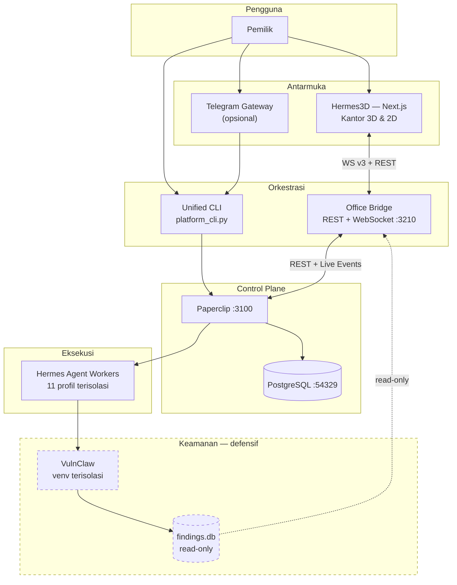
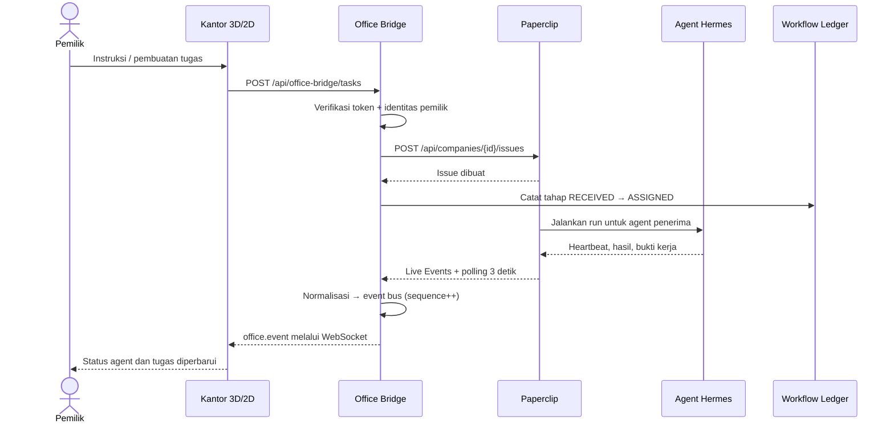

# ALLINONE-AGENT

**Unified Autonomous AI Company & Interactive 3D Virtual Office**

> Bahasa Indonesia (dokumen ini) · [English](README_EN.md)

ALLINONE-AGENT adalah platform orkestrasi multi-agent untuk Windows yang menjalankan sebuah "perusahaan AI" berisi 11 peran kerja, lengkap dengan antarmuka kantor virtual 3D dan 2D untuk mengamati serta mengendalikannya secara langsung. Repositori ini merupakan hasil konsolidasi platform yang sebelumnya hanya berjalan di satu komputer pribadi menjadi satu produk yang dapat dipasang ulang di komputer lain.

Setiap klaim teknis dalam dokumen ini diverifikasi langsung terhadap kode sumber — nama endpoint, variabel environment, nilai default, perintah, dan hasil pengujian dibaca dari implementasi nyata, bukan disalin dari catatan perencanaan. Ketika sebuah klaim lama terbukti keliru, dokumen ini mengoreksinya secara eksplisit. Bagian [Keterbatasan yang Diketahui](#keterbatasan-yang-diketahui) memuat seluruh hal yang belum terbukti dan wajib dibaca sebelum platform ini dipakai untuk kebutuhan penting.

---

## Daftar Isi

- [Latar Belakang dan Tujuan](#latar-belakang-dan-tujuan)
- [Fitur Utama](#fitur-utama)
- [Arsitektur Sistem](#arsitektur-sistem)
- [Alur Kerja Aplikasi](#alur-kerja-aplikasi)
- [Teknologi yang Digunakan](#teknologi-yang-digunakan)
- [Struktur Direktori](#struktur-direktori)
- [Persyaratan Sistem](#persyaratan-sistem)
- [Instalasi](#instalasi)
- [Konfigurasi](#konfigurasi)
- [Referensi Environment Variable](#referensi-environment-variable)
- [Menjalankan Platform](#menjalankan-platform)
- [Dokumentasi Fitur](#dokumentasi-fitur)
- [Referensi API](#referensi-api)
- [Referensi CLI](#referensi-cli)
- [Autentikasi dan Otorisasi](#autentikasi-dan-otorisasi)
- [Penyimpanan Data](#penyimpanan-data)
- [Penanganan Error](#penanganan-error)
- [Logging dan Monitoring](#logging-dan-monitoring)
- [Pengujian](#pengujian)
- [CI/CD](#cicd)
- [Build dan Deployment](#build-dan-deployment)
- [Troubleshooting](#troubleshooting)
- [Pertanyaan yang Sering Diajukan](#pertanyaan-yang-sering-diajukan)
- [Keamanan dan Privasi](#keamanan-dan-privasi)
- [Kontribusi](#kontribusi)
- [Lisensi](#lisensi)
- [Kredit dan Komponen Upstream](#kredit-dan-komponen-upstream)
- [Keterbatasan yang Diketahui](#keterbatasan-yang-diketahui)
- [Roadmap](#roadmap)
- [Dokumentasi Lanjutan](#dokumentasi-lanjutan)
- [Dukungan](#dukungan)

---

## Latar Belakang dan Tujuan

### Masalah yang diselesaikan

Asisten AI pada umumnya bersifat satu sesi, satu konteks, dan satu identitas. Ketika sebuah pekerjaan membutuhkan pembagian peran — misalnya seorang yang merencanakan, seorang yang menulis kode, seorang yang menguji, dan seorang lagi yang meninjau keamanannya — pendekatan satu sesi memaksa pengguna menjadi perantara manual antar peran tersebut, sekaligus kehilangan jejak audit mengenai siapa mengerjakan apa dan atas dasar otorisasi apa.

ALLINONE-AGENT mengatasi hal tersebut dengan menjalankan setiap peran sebagai agent terpisah yang memiliki identitas sendiri di sebuah *control plane*, profil runtime terisolasi, anggaran bulanan sendiri, batas izin sendiri, dan ruang kerja sendiri. Seluruh aktivitasnya kemudian divisualisasikan sebagai kantor virtual sehingga status pekerjaan dapat diamati tanpa perlu membaca log mentah.

### Tujuan proyek

1. **Reproduktibilitas.** Platform yang semula terikat pada satu komputer dapat dipasang ulang di komputer lain melalui installer, templat konfigurasi, dan manifest versi yang terkunci.
2. **Isolasi dan batas kepercayaan yang tegas.** Setiap agent berjalan pada profil terpisah dengan kredensial masing-masing; komponen keamanan bersifat *read-only*; endpoint yang mengubah state bersifat *fail-closed*.
3. **Akuntabilitas.** Setiap keputusan otorisasi, transisi tugas, dan event sistem dicatat ke jejak audit yang dapat ditelusuri ulang.
4. **Kejujuran dokumentasi.** Dokumen ini membedakan secara tegas antara yang sudah diuji, yang baru terverifikasi secara struktural, dan yang belum terbukti sama sekali.

### Apa yang bukan proyek ini

Platform ini **bukan** chatbot, **bukan** layanan SaaS multi-tenant, dan **bukan** perangkat keamanan ofensif. Seluruh layanan mengikat diri ke alamat *loopback* (`127.0.0.1`) dan menolak *binding* ke alamat publik tanpa token akses; integrasi VulnClaw dibatasi hanya pada pembacaan temuan keamanan.

## Fitur Utama

### Organisasi 11 agent dengan dua gelombang aktivasi

Platform menyediakan 11 peran kerja yang terdefinisi secara deklaratif di `integration/org_provisioner.py`. Setiap peran memiliki jabatan, atasan, anggaran bulanan, batas waktu eksekusi, batas giliran percakapan, dan kategori tool yang diizinkan.

| Slug peran | Jabatan | Melapor ke | Gelombang | Anggaran (¢/bulan) | Timeout | Maks. giliran | Toolset |
|---|---|---|---|---|---|---|---|
| `ceo_agent` | Chief Executive Officer — Planning & Delegation | — | **Wave-1 (aktif)** | 2500 | 240 s | 20 | file, terminal |
| `cto_agent` | Chief Technology Officer — Architecture & Standards | `ceo_agent` | Wave-2 (standby) | 1500 | 240 s | 18 | file, terminal |
| `backend_developer` | Senior Full-Stack / Backend Software Engineer | `ceo_agent` | **Wave-1 (aktif)** | 3000 | 420 s | 25 | file, terminal |
| `frontend_developer` | Senior Frontend & UI Engineer | `cto_agent` | Wave-2 (standby) | 1500 | 240 s | 20 | file, terminal |
| `devops_engineer` | Senior DevOps & Runtime Diagnostics Engineer | `cto_agent` | Wave-2 (standby) | 1500 | 240 s | 18 | file, terminal |
| `qa_engineer` | Lead Quality Assurance & Regression Engineer | `ceo_agent` | **Wave-1 (aktif)** | 2000 | 240 s | 20 | file, terminal |
| `security_lead` | Defensive Security Architecture Lead | `ceo_agent` | Wave-2 (standby) | 1500 | 180 s | 15 | file |
| `security_reviewer` | Defensive Code & Findings Security Reviewer | `ceo_agent` | **Wave-1 (aktif)** | 2000 | 180 s | 15 | file |
| `findings_analyst` | Security Findings Triage & Deduplication Analyst | `security_lead` | Wave-2 (standby) | 1000 | 180 s | 12 | file |
| `remediation_reviewer` | Security Remediation & Regression Verifier | `security_lead` | Wave-2 (standby) | 1000 | 180 s | 12 | file |
| `compliance_reporter` | Audit Evidence & Acceptance Compliance Specialist | `ceo_agent` | Wave-2 (standby) | 1000 | 180 s | 12 | file |

**Mengapa dua gelombang.** Menjalankan 11 agent secara bersamaan pada perangkat kelas bawah akan menghabiskan memori dan anggaran token tanpa manfaat yang sepadan. Karena itu hanya empat agent Wave-1 yang berstatus `idle` (siap menerima tugas) setelah provisioning; tujuh sisanya berstatus `paused` dan baru diaktifkan saat dibutuhkan. Perintah `resume-wave1` mengembalikan konfigurasi ini apabila terjadi penyimpangan.

**Batas izin.** Seluruh agent dibuat dengan `canCreateAgents: false` dan `canCreateSkills: false` — tidak ada agent yang boleh merekrut agent baru atau menambah kemampuan sendiri. Hanya `ceo_agent`, `cto_agent`, dan `security_lead` yang memiliki `canAssignTasks: true`.

### Kantor virtual 3D dan 2D

Mode 3D (`src/features/retro-office/`) merender kantor menggunakan Three.js melalui React Three Fiber, lengkap dengan sistem navigasi berbasis *nav grid* dan algoritma A\* untuk menggerakkan avatar agent antar ruangan. Mode 2D (`src/features/pixel-office/`) menyediakan representasi piksel berbasis Phaser untuk perangkat tanpa akselerasi grafis memadai.

Kedua mode **tidak** memiliki sumber data sendiri-sendiri. Keduanya merupakan konsumen dari lapisan bersama `src/features/office/` dan berlangganan pada aliran event yang sama dari Office Bridge, sehingga perpindahan mode tidak memicu pekerjaan baru atau menampilkan status yang berbeda. Pemilihan mode ditangani oleh `src/features/office/renderMode.ts`.

### Sinkronisasi real-time dengan jejak yang dapat diputar ulang

Office Bridge melakukan rekonsiliasi terhadap Paperclip setiap **3000 ms** dan juga berlangganan pada aliran Live Events milik Paperclip. Setiap perubahan dinormalisasi menjadi event dengan nomor urut (`sequence`) yang monoton, dipublikasikan ke seluruh pelanggan, sekaligus ditambahkan ke berkas `office-data/event-history/recent-events.jsonl`.

Konsekuensinya, klien yang terputus dapat meminta pemutaran ulang sejak nomor urut tertentu melalui parameter `?sinceSeq`, dan riwayat tersebut tetap bertahan setelah layanan direstart. Terdapat 48 tipe event yang diizinkan, mencakup siklus hidup agent, tugas, eksekusi (*run*), pemanggilan tool, persetujuan, build, pengujian, temuan keamanan, pemeliharaan, konektivitas runtime, dan rapat.

### Siklus hidup tugas 13 tahap

`integration/workflow_engine.py` memodelkan tugas sebagai mesin status 13 tahap yang dipetakan ke status Paperclip, lengkap dengan pencatatan ke SQLite (`data/workflow-ledger.db`), deteksi siklus pada dependensi, kunci idempotensi, dan batas delegasi.

| Tahap internal | Status Paperclip |
|---|---|
| `RECEIVED`, `TRIAGED` | `backlog` |
| `PLANNED`, `ASSIGNED` | `todo` |
| `PENDING_APPROVAL`, `FAILED`, `BLOCKED` | `blocked` |
| `IN_PROGRESS` | `in_progress` |
| `IN_REVIEW`, `IN_TESTING`, `READY_FOR_ACCEPTANCE` | `in_review` |
| `COMPLETED` | `done` |
| `CANCELLED` | `cancelled` |

Batas default (dari `config/resource-limits.json`): kedalaman delegasi maksimum **2**, subtugas per induk maksimum **6**, percobaan ulang per tugas maksimum **2**, dan tugas rekayasa paralel maksimum **1**.

### Integrasi keamanan defensif

`integration/vulnclaw_defensive.py` menjalankan VulnClaw di dalam virtual environment terpisah dengan environment yang telah dibersihkan — variabel milik Hermes dan Telegram sengaja tidak diteruskan. Terdapat gerbang kapabilitas (`assert_capability_allowed`) yang menolak kapabilitas ofensif.

Temuan disimpan di `data/findings/findings.db` melalui `findings_engine.py`, yang melakukan deduplikasi berbasis *fingerprint*, validasi CWE/CVE, serta menetralkan upaya *prompt injection* yang tertanam di dalam data temuan. Office Bridge membaca basis data ini dalam mode **read-only** secara eksplisit (`new DatabaseSync(path, { open: true, readOnly: true })`) dan tidak memiliki jalur tulis apa pun ke VulnClaw.

### Rapat multi-agent

Office Bridge menyediakan endpoint pembuatan dan penyelesaian rapat yang bersifat *owner-only*, dengan status rapat tersimpan pada `standup-store.json` dan tercermin di kedua mode kantor. Pada sisi antarmuka 3D, tersedia perhitungan kursi rapat dan penentuan rute avatar menuju ruang rapat.

> **Catatan ketelitian.** Pengujian otomatis yang tersedia untuk fitur ini (`apps/hermes3d/tests/unit/standup3dAll11Agents.test.ts`) memvalidasi **geometri kursi dan pathfinding**, yaitu ketersediaan minimal 14 kursi rapat yang seluruhnya dapat dijangkau algoritma A\*, serta pengecualian peserta rapat dari mekanisme *collision bump*. Pengujian tersebut **tidak** menjalankan agent, model bahasa, maupun Paperclip. Rincian lengkap ada di [Pengujian](#pengujian).

### Integrasi Telegram opsional

Platform dapat menerima perintah pemilik melalui Telegram dengan 12 perintah tervalidasi. Setiap pemanggilan melewati `WorkflowEngine.assert_owner_authorized()` terlebih dahulu. Integrasi ini sepenuhnya opsional — kantor virtual berjalan penuh tanpa bot apa pun.

### Pemeliharaan dan pemulihan mandiri

`PlatformHealthWatchdog` berjalan setiap 15 menit untuk memeriksa layanan, menjalankan ulang scheduled task yang berhenti, dan — hanya jika sebuah proses benar-benar tidak responsif dan berusia minimal 1,5 menit — menghentikannya agar launcher memulihkannya. `PlatformMaintenance` menjalankan siklus pemeliharaan harian. Keduanya menghormati `maintenance.lock`, sehingga pemeliharaan tidak saling bertabrakan dengan pemulihan otomatis.

## Arsitektur Sistem



### Tanggung jawab setiap komponen

| Komponen | Tanggung jawab | Sifat |
|---|---|---|
| **Paperclip** | *Control plane*: menyimpan identitas agent, antrean tugas, eksekusi, kebijakan anggaran, dan persetujuan. Seluruh identitas dibuat oleh Paperclip, bukan di-*hardcode*. | Upstream resmi, versi terkunci, tidak dimodifikasi |
| **Hermes Agent** | *Execution engine*: menjalankan setiap agent pada profil terisolasi dengan kredensial masing-masing. Menyediakan gateway Telegram. | Upstream resmi via npm bridge |
| **Office Bridge** | Menormalkan state dari Paperclip menjadi aliran event, menyediakan REST dan dua protokol WebSocket, menegakkan otorisasi pemilik, serta menyajikan temuan keamanan secara *read-only*. | Kode asli repositori ini |
| **Hermes3D** | Antarmuka kantor 3D/2D, gerbang akses Studio, dan proksi WebSocket menuju Office Bridge. | Upstream di-*vendor* penuh dengan patch lokal |
| **VulnClaw** | Analisis keamanan defensif; dijalankan pada venv terisolasi dengan environment bersih. | Upstream resmi, versi terkunci |
| **Unified CLI** | Agregasi kesehatan lintas komponen, operasi darurat, dan jembatan perintah Telegram. | Kode asli repositori ini |

### Batas kepercayaan

1. **Loopback saja.** Office Bridge menolak *binding* ke alamat non-loopback (melempar error saat startup), dan *upgrade* WebSocket hanya diterima dari IP loopback.
2. **Daftar origin.** Hanya `http://127.0.0.1:3200`, `http://localhost:3200`, `http://127.0.0.1:3210`, dan `http://localhost:3210` yang diterima apabila header `Origin` dikirim.
3. **Mutasi hanya untuk pemilik.** Seluruh metode selain `GET`, `HEAD`, dan `OPTIONS` memerlukan identitas pemilik yang cocok dengan `ALLINONE_TELEGRAM_OWNER_ID`.
4. **Keamanan hanya membaca.** Aliran data dari VulnClaw menuju Office Bridge bersifat satu arah dan *read-only*.
5. **Akses berkas terkurung.** Pembacaan bukti kerja dibatasi pada `workspaces/`, `reports/`, dan `docs/` di bawah `ALLINONE_HOME`, dengan penolakan eksplisit terhadap direktori Hermes, `config/secrets/`, `data/vulnclaw/`, dan `C:\Windows`.

## Alur Kerja Aplikasi

Diagram berikut menunjukkan perjalanan sebuah instruksi pemilik hingga menjadi hasil kerja yang dapat diaudit.



**Penjelasan tahapan.** Instruksi masuk melalui antarmuka kantor, Telegram, atau CLI. Office Bridge memverifikasi token sekaligus identitas pemilik sebelum meneruskannya sebagai *issue* di Paperclip. Paperclip menjadwalkan eksekusi ke agent yang sesuai; agent berjalan pada profil Hermes terisolasi miliknya. Seluruh perubahan status dikembalikan ke Office Bridge melalui kombinasi *polling* dan Live Events, dinormalisasi menjadi event bernomor urut, lalu disiarkan ke antarmuka. Secara paralel, `workflow_engine` mencatat transisi tahap ke *ledger* sehingga perjalanan setiap tugas dapat ditelusuri ulang.

## Teknologi yang Digunakan

| Lapisan | Teknologi | Versi | Perannya dalam proyek |
|---|---|---|---|
| Framework antarmuka | Next.js | 16.4.6 | Menyajikan aplikasi kantor virtual dan route API internalnya |
| Pustaka UI | React / React DOM | 19.2.3 | Lapisan komponen antarmuka |
| Render 3D | Three.js | ^0.185.1 | Mesin render kantor 3D |
| Integrasi 3D–React | @react-three/fiber, @react-three/drei | ^9.7.0, ^10.7.8 | Menjembatani Three.js dengan React, menyediakan helper scene |
| Render 2D | Phaser | ^3.90.0 | Mesin render kantor mode piksel 2D |
| Transport real-time | `ws` | ^8.23.0 | Server WebSocket Office Bridge dan proksi Hermes3D |
| Orkestrasi & CLI | Python 3 | 3.11+ | Seluruh modul `integration/`; hanya memakai pustaka standar |
| Automasi sistem | PowerShell | 5.1+ | Installer, siklus hidup layanan, watchdog, pemeliharaan |
| Layanan Windows | C# / .NET | 8.0 | Launcher dengan supervisi proses, backoff, dan proteksi *crash loop* |
| Control plane | Paperclip | commit `3dffb2c9` | Manajemen agent, tugas, anggaran, persetujuan |
| Basis data | PostgreSQL | — | Penyimpanan Paperclip (port 54329, dikelola Paperclip) |
| Penyimpanan lokal | SQLite melalui `node:sqlite` | bawaan Node ≥ 22.5 | Temuan keamanan dan *workflow ledger*, dibaca *read-only* |
| Pengujian | Vitest, Playwright | ^5.1.1, ^1.58.0 | Pengujian unit dan *end-to-end* antarmuka |
| CI | GitHub Actions | — | Typecheck, build, parse PowerShell, build .NET, pemindaian rahasia |

## Struktur Direktori

```text
ALLINONE-AGENT/
├── install.ps1              # Orkestrator instalasi 8 tahap
├── install.cmd              # Pembungkus batch (ExecutionPolicy per-proses)
├── setup.ps1                # Wizard konfigurasi awal
├── start.ps1 / stop.ps1 / restart.ps1
├── health.ps1               # Pemeriksaan kesehatan layanan dan endpoint
├── update.ps1 / uninstall.ps1
│
├── apps/
│   ├── hermes3d/            # Antarmuka kantor (Next.js)
│   │   ├── server/index.js  # Entry point sebenarnya: access gate, proksi WS, kebijakan jaringan
│   │   ├── src/features/
│   │   │   ├── retro-office/      # Scene 3D: navigation.ts (nav grid + A*), objects, systems
│   │   │   ├── pixel-office/      # Scene 2D Phaser: art, map, sim, PixelSceneBridge
│   │   │   ├── office/            # Lapisan bersama 3D & 2D: state, hooks, renderMode.ts
│   │   │   ├── enterprise-company/# Overlay perusahaan dan data live
│   │   │   └── agents/            # Panel agent: approvals, operations, state
│   │   └── tests/           # 187 berkas unit (Vitest) + 10 spec Playwright
│   └── office-bridge/       # Jembatan sinkronisasi (kode asli)
│       ├── server.js        # Router HTTP + dua endpoint WebSocket
│       ├── authorization/   # Token, identitas pemilik, rate limit, audit
│       ├── adapters/        # Paperclip, VulnClaw (read-only), analytics
│       ├── contracts/       # Skema event, redaksi, path jail
│       └── events/          # Event bus ternormalisasi + sinkronisasi real-time
│
├── integration/             # 8 modul Python (lihat Referensi CLI)
├── agents/roles/            # 11 peran: AGENTS.md + role-manifest.json per peran
├── automation/
│   ├── launchers/           # PaperclipServiceLauncher, OfficeServiceLauncher (C#)
│   ├── scheduled-tasks/     # Registrasi Windows Task Scheduler
│   ├── watchdog/            # platform-watchdog.ps1 (interval 15 menit)
│   ├── updater/             # Pembaruan Hermes Agent + utilitas Telegram
│   └── maintenance/         # Rotasi kredensial, verifikasi batas keamanan
│
├── config/                  # Templat konfigurasi (*.example.*)
├── scripts/lib/             # Preflight.psm1, InstallState.psm1
├── upstream/                # components.lock.json + patch Hermes3D
├── tests/                   # Fixture sintetis, integrasi, e2e tingkat platform
├── docs/                    # Dokumentasi teknis rinci
└── .github/workflows/       # ci.yml, security-audit.yml, windows-build.yml
```

Direktori runtime (`data/`, `runtime/`, `logs/`, `workspaces/`, `office-data/`) **tidak** disertakan dalam repositori; seluruhnya dibuat di bawah `ALLINONE_HOME` saat instalasi dan dikecualikan oleh `.gitignore`.

## Persyaratan Sistem

| Komponen | Persyaratan | Penjelasan |
|---|---|---|
| Sistem operasi | Windows 10 22H2 x64 atau Windows 11 | Mesin referensi memakai Windows 10 Pro build 19045. Installer tidak memverifikasi apakah edisi Anda masih menerima pembaruan keamanan — periksa sendiri sebelum memakai mesin ini untuk sesuatu yang terhubung ke internet. |
| Node.js | **≥ 22.0.0 (wajib)** | Adapter temuan VulnClaw dan analytics memakai modul bawaan `node:sqlite` yang baru tersedia pada Node 22.5+. Pada Node 20 ketiga adapter gagal dimuat total. Preflight memeriksa dua lokasi: `node` pada PATH sistem **dan** runtime Node yang dikelola sendiri oleh Hermes Agent di `%LOCALAPPDATA%\hermes\tools\node-*-win32-x64\`; cukup salah satu memenuhi syarat. |
| Git | Wajib | Tahap *upstream retrieval* melakukan `git clone` ke commit yang terkunci. |
| Python | 3.11+ | Seluruh modul `integration/` hanya memakai pustaka standar — tidak ada `pip install` yang diperlukan untuk CLI inti. Hermes Agent upstream mensyaratkan Python 3.11. |
| .NET SDK | 8.0 (opsional) | Hanya diperlukan untuk mengompilasi ulang launcher C#. Tidak wajib jika Anda tidak membangun ulang launcher. |
| RAM | Tidak ada batas minimum yang ditegakkan | Preflight memberi `Pass` pada ≥ 8 GB, `Warn` pada ≥ 4 GB, dan `Fail` di bawahnya — namun detailnya menyatakan bahwa proyek ini belum diuji pada cukup banyak variasi perangkat keras untuk menetapkan angka minimum universal. Mesin referensi: Intel Pentium G5400, RAM 8 GB, GPU NVIDIA GT 710 2 GB. |
| Disk | ≥ 8 GB bebas | Preflight memakai ambang 8 GB. Build Hermes3D sendiri menghasilkan sekitar 900 MB `node_modules` dan `.next`. |
| GPU | WebGL untuk mode 3D | Mode 2D Phaser tersedia sebagai alternatif untuk perangkat tanpa GPU memadai. |
| Jaringan | Diperlukan saat instalasi | Untuk `git clone` dependensi upstream dan pemasangan paket npm. |

## Instalasi

### Mulai cepat

```powershell
git clone https://github.com/Vistapra/ALLINONE-AGENT.git
cd ALLINONE-AGENT
.\install.ps1 -DryRun
```

`-DryRun` menampilkan rencana instalasi lengkap lalu berhenti tanpa mengubah apa pun. Setelah rencana diperiksa:

```powershell
.\install.ps1
.\setup.ps1
.\start.ps1
.\health.ps1
```

Alternatif melalui pembungkus batch, yang menerapkan `ExecutionPolicy Bypass` hanya pada proses tersebut dan tidak mengubah kebijakan sistem:

```text
install.cmd
```

### Parameter installer

| Parameter | Tipe | Default | Keterangan |
|---|---|---|---|
| `-InstallPath` | string | `$env:ALLINONE_HOME`, lalu `$HOME\ALLINONE-AGENT` | Lokasi pemasangan (`ALLINONE_HOME`) |
| `-Mode` | `Auto`/`Fresh`/`Adopt`/`Repair`/`Dev` | `Auto` | Mode instalasi; `Auto` mendeteksi sendiri |
| `-DryRun` | switch | — | Menampilkan rencana lalu keluar dengan kode 0 |
| `-Force` | switch | — | Mengabaikan tahap yang sudah tercatat selesai |
| `-NonInteractive` | switch | — | Menolak prompt interaktif |
| `-WhatIf` / `-Confirm` | switch | — | Disediakan otomatis oleh `SupportsShouldProcess` |

### Mode instalasi

| Mode | Kapan dipakai |
|---|---|
| **Fresh** | Komputer belum memiliki instalasi ALLINONE-AGENT, Hermes, maupun Paperclip. |
| **Adopt** | Terdeteksi instalasi yang sudah ada. Installer memakainya kembali tanpa menduplikasi layanan, basis data, atau scheduled task, dan tidak menimpa konfigurasi yang sudah ada. Ini satu-satunya jalur yang sudah diuji *end-to-end*. |
| **Repair** | Memperbaiki dependensi atau konfigurasi tanpa menghapus data aktif; kegagalan preflight tidak menghentikan proses. |
| **Dev** | Menyiapkan lingkungan pengembangan. |

Deteksi mode (`Get-AllinoneInstallMode`) memeriksa empat sinyal: keberadaan direktori Hermes, paket `hermes-agent` global, scheduled task platform yang terdaftar, dan `ALLINONE_HOME` yang valid. Satu sinyal saja sudah cukup untuk memilih `Adopt-Existing`.

### Tahapan yang dijalankan installer

| Tahap | Nama | Tindakan |
|---|---|---|
| 1 | Preflight | 11 pemeriksaan: OS, RAM, disk, Node ≥ 22, Git, Python, empat port, konektivitas jaringan. Kegagalan port bersifat peringatan, bukan penghenti. |
| 2 | Install Plan | Menampilkan mode, lokasi, dan rencana. `-DryRun` berhenti di sini. Setelah tahap ini direktori dibuat dan kunci singleton diambil. |
| 3 | Dependency Resolution & Upstream Retrieval | Membaca `upstream/components.lock.json`, melakukan `git clone` Paperclip dan VulnClaw ke commit terkunci di `upstream-checkouts/`. Hermes Agent **tidak** dipasang otomatis — installer mencetak perintah `npm install -g hermes-agent@<versi>` untuk dijalankan sendiri. Hermes3D tidak perlu diambil karena sudah di-*vendor*. |
| 4 | Local Configuration | Menyalin tiga templat menjadi konfigurasi lokal. **Tidak pernah menimpa** berkas yang sudah ada. |
| 5 | Database Initialization | **Stub.** Hanya mencetak keterangan; inisialisasi PostgreSQL tertanam belum diimplementasikan. Pada mode non-Adopt, installer menunjuk ke `scripts/bootstrap_and_verify_paperclip.py` yang sengaja tidak dijalankan otomatis karena mencetak kredensial nyata, membuat perusahaan awal, serta menghentikan dan menjalankan ulang task Paperclip. |
| 6 | Agent & Office Provisioning | **Hanya catatan.** `integration/org_provisioner.py` sengaja tidak dijalankan otomatis agar Anda tidak memperoleh identitas agent yang tidak Anda minta. |
| 7 | Scheduled Tasks | Pada mode Adopt: membiarkan task apa adanya. Pada mode lain: mencetak skrip registrasi yang **tidak** dijalankan otomatis karena mengubah state sistem di luar checkout ini. |
| 8 | Health Verification & Report | Menulis `runtime/installation-report.md`. Tahap ini selalu dijalankan. |

Tahap 3 sampai 7 bersifat *idempotent* — dicatat di `runtime/install-state.json` dan dilewati pada eksekusi berikutnya kecuali `-Force` diberikan.

> **Penting.** Installer sengaja berhenti pada batas tertentu. Inisialisasi basis data, provisioning identitas agent, dan registrasi scheduled task merupakan tindakan yang mengubah sistem di luar direktori repositori, sehingga ketiganya ditampilkan sebagai langkah eksplisit untuk Anda tinjau dan jalankan sendiri, bukan dieksekusi diam-diam.

### Konfigurasi awal dengan `setup.ps1`

`setup.ps1` mengumpulkan — secara berurutan — base URL provider model, nama model, lalu membuat token pemilik secara otomatis, menanyakan apakah Telegram diaktifkan (default tidak), dan terakhir daftar ruang kerja yang diizinkan.

- **Token pemilik** dibuat dari 32 byte acak kriptografis, dikodekan Base64 ramah-URL, **ditampilkan satu kali**, lalu disimpan sebagai `STUDIO_ACCESS_TOKEN`.
- **Daftar ruang kerja** menolak entri berupa akar drive (misalnya `C:\`) — entri semacam itu diberi peringatan dan dibuang, sejalan dengan prinsip otorisasi yang bersifat *opt-in*.
- **Mode non-interaktif** (`-NonInteractive -ConfigFile <berkas.json>`) membaca seluruh jawaban dari JSON dengan kunci `InstallPath`, `ModelProvider`, `ModelApiBaseUrl`, `ModelName`, `EnableTelegram`, `TelegramBotToken`, `TelegramOwnerId`, dan `WorkspaceAllowlist[]`.

Dua hal ditandai `[NOT VERIFIED]` langsung di dalam kode: verifikasi konektivitas provider model secara *live* dan validasi token Telegram ke API Telegram. Keduanya belum diimplementasikan dan tidak diklaim berfungsi.

## Konfigurasi

Seluruh berkas templat berada di `config/` dengan akhiran `.example`. Salin menjadi berkas lokal tanpa akhiran tersebut, lalu isi nilainya. Berkas hasil salinan sudah dikecualikan oleh `.gitignore`.

| Templat | Berkas tujuan | Isi |
|---|---|---|
| `platform.local.env.example` | `config/platform.local.env` | Variabel environment inti: port, provider model, koneksi Paperclip, token Studio, Telegram, governance, dan referensi harga token |
| `resource-limits.example.json` | `config/resource-limits.json` | Profil host dan 16 batas sumber daya (delegasi, giliran, timeout, rotasi log) |
| `organization-roster.example.json` | `config/organization-roster.json` | Peta identitas organisasi; nilainya diisi saat provisioning |
| `paperclip-agent-profile.example.env` | `.env` di tiap profil agent | Kredensial Paperclip per agent — kunci berbeda untuk setiap peran, tidak pernah dipakai bersama |
| `office-bridge-auth.example.json` | `config/secrets/office-bridge-auth.json` | Bentuk berkas token Office Bridge |
| `maintenance.example.json` | Konfigurasi pemeliharaan | Jendela 03.00 Asia/Jakarta, *catch-up* luring, penundaan saat ada pekerjaan aktif, interval watchdog, ambang disk |
| `permissions.example.json` | — | Referensi perencanaan izin dan strategi gelombang |
| `telegram.example.yaml` | — | Referensi bentuk konfigurasi Telegram |

> **Dua templat bersifat referensi, bukan konfigurasi aktif.** `telegram.example.yaml` menyatakan sendiri di bagian kepalanya bahwa berkas tersebut tidak dibaca langsung oleh platform — nilai Telegram yang sebenarnya dibaca dari `platform.local.env`. Demikian pula `permissions.example.json` menyatakan dirinya belum merupakan skema yang ditegakkan sampai dihubungkan ke gerbang izin yang sesungguhnya. Keduanya tetap disertakan karena berguna sebagai rujukan perencanaan, bukan karena sudah aktif.

## Referensi Environment Variable

### Variabel `ALLINONE_*` yang benar-benar dibaca kode

| Variabel | Dibaca oleh | Fungsi | Default | Status |
|---|---|---|---|---|
| `ALLINONE_HOME` | Office Bridge, Hermes3D, launcher C#, skrip pemeliharaan | Akar platform; seluruh direktori lain diturunkan darinya | `~/ALLINONE-AGENT` | Opsional |
| `ALLINONE_HERMES_HOME` | Adapter Office Bridge, seluruh launcher, pembaru Hermes | Akar instalasi Hermes Agent | `~/AppData/Local/hermes` | Opsional |
| `ALLINONE_USER_HOME` | Skrip kesehatan, pembaru, utilitas Telegram | Akar profil pengguna; dipakai menemukan `HermesUpdater/` | Direktori home pengguna | Opsional |
| `ALLINONE_TELEGRAM_OWNER_ID` | `authorization/auth.js`, `agent-chat-engine.js`, adapter analytics | Identitas pemilik satu-satunya yang boleh menjalankan endpoint mutasi | `null` | **Wajib** agar endpoint mutasi dapat dipakai |
| `ALLINONE_TELEGRAM_BOT_HANDLE` | `server.js`, utilitas Telegram | Nama bot untuk tampilan saja | `"unconfigured"` | Opsional |
| `ALLINONE_EXTRA_AUTHORIZED_ROOTS` | Path jail Office Bridge, route saran path | Akar direktori tambahan yang diizinkan, dipisah `;`. Kosong berarti tidak ada kepercayaan tambahan | `""` | Opsional |
| `ALLINONE_CUSTOM_PROVIDER_URL` | `hermes_worker_factory.py`, rotasi kredensial | Base URL provider model | `https://api.openai.com/v1` | Opsional |
| `ALLINONE_PAPERCLIP_COMPANY_ID` | `office-bridge/server.js` | Company ID cadangan saat Paperclip tidak terjangkau | UUID nol | Opsional |
| `ALLINONE_POSTGRES_URL` | `scripts/clear-orphan-cancelled-runs.cjs` | DSN PostgreSQL untuk skrip pembersih *run* yatim | DSN pengembangan lokal | Opsional |

> **Koreksi terhadap dokumentasi sebelumnya.** Variabel `ALLINONE_DATA_DIR`, `ALLINONE_RUNTIME_DIR`, `ALLINONE_CONFIG_DIR`, `ALLINONE_LOG_DIR`, dan `ALLINONE_WORKSPACE_DIR` **tidak diimplementasikan** di mana pun dalam kode. Keduanya sempat dicantumkan sebagai variabel nyata pada versi dokumen sebelumnya; faktanya direktori-direktori tersebut merupakan subpath tetap di bawah `ALLINONE_HOME`, sebagaimana juga dinyatakan di `docs/CONFIGURATION.md`.

### Variabel layanan dan port

| Variabel | Dibaca oleh | Fungsi | Default |
|---|---|---|---|
| `PORT` | `apps/hermes3d/server/index.js` | Port dengar Hermes3D | **3000** |
| `HOST` | Kebijakan jaringan Hermes3D | Alamat bind Hermes3D | `127.0.0.1` |
| `OFFICE_BRIDGE_PORT` | `office-bridge/server.js` | Port Office Bridge | `3210` |
| `OFFICE_BRIDGE_HOST` | `office-bridge/server.js` | Alamat bind Office Bridge (wajib loopback) | `127.0.0.1` |
| `OFFICE_BRIDGE_WS_URL` | `hermes3d/server/index.js` | Target proksi WebSocket dari Hermes3D | `ws://127.0.0.1:3210` |
| `HERMES3D_PORT` | `office-bridge/server.js` saja | Lokasi Hermes3D **menurut Office Bridge**; tidak mengatur port Hermes3D | `3200` |
| `HERMES_ADAPTER_PORT` | `server/hermes-gateway-adapter.js` | Port adapter gateway Hermes | `18789` |
| `STUDIO_ACCESS_TOKEN` | `server/index.js`, kebijakan jaringan | Gerbang akses Studio; wajib apabila hendak bind ke alamat non-localhost | — |
| `HERMES3D_GATEWAY_URL`, `HERMES3D_GATEWAY_TOKEN` | Pengaturan Studio Hermes3D | Endpoint gateway saat runtime tanpa perlu build ulang | — |
| `NEXT_PUBLIC_GATEWAY_URL` | Klien Hermes3D (build-time) | URL gateway untuk browser; perubahan memerlukan build ulang | `ws://localhost:18789` |
| `HERMES_API_URL`, `HERMES_API_KEY`, `HERMES_MODEL` | Adapter Hermes | Endpoint, kredensial, dan nama model provider | — |
| `PAPERCLIP_API_URL`, `PAPERCLIP_API_KEY` | Paperclip dan `integration/` | Koneksi ke control plane | `http://127.0.0.1:3100` |
| `CUSTOM_API_BASE_URL`, `CUSTOM_MODEL_NAME` | `agent-chat-engine.js` | Endpoint dan model untuk mesin percakapan agent | Tidak ada default untuk base URL; model `combo/X` |
| `PLATFORM_REF_*_USD_PER_1M` | Adapter analytics | Tarif referensi untuk memperkirakan biaya ketika model melaporkan token tanpa harga | — |

> **Dua ketidakkonsistenan yang perlu Anda ketahui.**
> 1. `setup.ps1` menulis `TELEGRAM_OWNER_ID`, sedangkan kode otorisasi membaca `ALLINONE_TELEGRAM_OWNER_ID`. Belum ditemukan kode yang menjembatani keduanya; apabila endpoint mutasi menolak seluruh permintaan setelah setup, periksa bahwa `ALLINONE_TELEGRAM_OWNER_ID` benar-benar terisi di lingkungan proses Office Bridge. Status: **belum terverifikasi**.
> 2. `platform.local.env.example` menetapkan `PORT=3100` (port Paperclip), padahal `PORT` adalah variabel yang dibaca Hermes3D. Apabila berkas tersebut dimuat utuh ke dalam proses Hermes3D, Hermes3D akan mencoba mengikat port 3100 dan bertabrakan dengan Paperclip. Apakah launcher menetapkan `PORT` secara per-proses **belum terverifikasi** — periksa sebelum menjalankan keduanya bersamaan.

## Menjalankan Platform

| Perintah | Fungsi |
|---|---|
| `.\start.ps1` | Menjalankan empat scheduled task yang dikelola platform |
| `.\stop.ps1` | Menghentikan keempat task tersebut |
| `.\restart.ps1` | `stop.ps1`, jeda 3 detik, lalu `start.ps1` |
| `.\health.ps1` | Memeriksa status task dan endpoint; keluar dengan kode 1 bila ada kegagalan |
| `.\update.ps1 [-CheckOnly]` | Memicu siklus pemeliharaan melalui task `PlatformMaintenance` |
| `.\uninstall.ps1 [-DeleteData]` | Mencabut komponen yang dikelola; data dipertahankan kecuali `-DeleteData` diberikan |

`health.ps1` menerima `-PaperclipPort`, `-Hermes3dPort`, dan `-OfficeBridgePort` apabila Anda memakai port non-default.

### Alamat layanan

| Layanan | Alamat default |
|---|---|
| Kantor virtual 3D/2D | `http://127.0.0.1:3200/office` |
| Paperclip | `http://127.0.0.1:3100` |
| Office Bridge | `http://127.0.0.1:3210` |
| PostgreSQL (dikelola Paperclip) | `127.0.0.1:54329` |

### Batas kepemilikan scheduled task

Platform ini mengelola **empat** task: `PaperclipServer`, `OfficeVirtualCompany`, `PlatformHealthWatchdog`, dan `PlatformMaintenance`. Empat task lain — `HermesAutoUpdate`, `Hermes_Gateway`, `HermesPostRebootVerify`, dan `cua-driver-serve` — adalah milik paket `hermes-agent` upstream dan **tidak pernah disentuh** oleh skrip mana pun di repositori ini, termasuk `uninstall.ps1`.

| Task | Pemicu | Batas waktu |
|---|---|---|
| `PaperclipServer` | Event jaringan (`NetworkProfile/Operational` ID 10000) + pengulangan tiap 1 menit | Tanpa batas |
| `OfficeVirtualCompany` | Saat logon; restart otomatis tiap 1 menit hingga 5 kali bila gagal | Tanpa batas |
| `PlatformHealthWatchdog` | Saat logon + tiap 15 menit | 5 menit |
| `PlatformMaintenance` | Harian pukul 03.02 (+07:00) + saat logon | 1 jam |

Task periodik seperti `PlatformHealthWatchdog` dan `PlatformMaintenance` berstatus `Ready` saat menunggu pemicu berikutnya — ini kondisi sehat, bukan kegagalan.

## Dokumentasi Fitur

### Provisioning organisasi

`integration/org_provisioner.py` menjalankan urutan berikut: mencari atau membuat perusahaan, menetapkan kebijakan anggaran tingkat perusahaan (12000 ¢ per bulan kalender UTC, dengan kebijakan `unpricedUsagePolicy: "allow"` karena model `combo/X` dapat melaporkan token tanpa harga), lalu untuk setiap peran membuat direktori profil Hermes terisolasi beserta penguncian ACL, membuat atau menyelaraskan agent di Paperclip, menetapkan izin dan anggaran, mengatur status awal sesuai gelombang, dan terakhir menerbitkan kunci API Paperclip khusus untuk agent tersebut.

Seluruh identitas — ID perusahaan maupun ID agent — diberikan oleh server Paperclip. Tidak ada identitas yang di-*hardcode* di repositori ini, sehingga setiap instalasi baru menghasilkan organisasi yang sepenuhnya baru.

### Percakapan dan penugasan agent

Endpoint `POST /api/office-bridge/agents/:id/chat` meneruskan pesan ke mesin percakapan yang dapat menghasilkan tiga jenis keluaran: balasan tekstual, tugas Paperclip baru, atau rapat baru. Riwayat percakapan tersimpan di `office-data/chat-history/` dan dapat dibaca kembali melalui endpoint `GET` pada path yang sama (40 pesan terakhir).

Mesin percakapan memuat kunci pekerja dari profil terisolasi `pcceoagent`, bukan dari state Hermes milik pemilik — pemisahan ini disengaja agar percakapan agent tidak pernah memperoleh kredensial pemilik.

### Idempotensi pembuatan tugas

Pembuatan tugas menerima `idempotency_key`. Permintaan berulang dengan kunci yang sama mengembalikan HTTP **200** dengan penanda `deduplicated`, bukan membuat tugas kedua; sedangkan pembuatan baru mengembalikan HTTP **201**. Hal ini penting pada jalur Telegram, yang membentuk kunci dari ID pemanggil dan ID pesan.

### Operasi darurat

Dua operasi tersedia baik melalui CLI maupun endpoint:

- **`emergency-stop`** membatalkan seluruh *run* berstatus `running` dan `queued`, lalu menjeda seluruh agent yang belum berstatus jeda atau selesai.
- **`resume-wave1`** mengembalikan keempat agent Wave-1 ke status aktif berdasarkan nama, menunggu transisi `pausing`/`stopping` selesai lebih dulu, dan menjeda sisanya.

### Analitik dan tata kelola

Adapter analytics membaca basis data state milik tiap profil Hermes secara *read-only* dan menggabungkannya dengan data biaya serta anggaran dari Paperclip. Ketika model melaporkan pemakaian token tanpa harga, sistem **tidak** menampilkannya sebagai `$0.00` melainkan mempertahankannya sebagai biaya tidak diketahui, dan dapat menghitung estimasi referensi memakai tarif yang Anda tetapkan melalui variabel `PLATFORM_REF_*`.

## Referensi API

Seluruh endpoint di bawah dilayani oleh Office Bridge pada `http://127.0.0.1:3210`. Kecuali `GET /health`, semuanya memerlukan token Office Bridge. Seluruh metode selain `GET`, `HEAD`, dan `OPTIONS` tambahan memerlukan identitas pemilik.

**Cara mengirim token** — salah satu dari: header `Authorization: Bearer <token>`, header `x-office-bridge-token: <token>`, atau parameter `?token=` (khusus *upgrade* WebSocket).

### Endpoint status dan state

| Metode | Path | Fungsi | Otorisasi |
|---|---|---|---|
| `GET` | `/health` | Status ringkas: `healthy` atau `degraded`, keterjangkauan Paperclip, nomor urut event terakhir | Publik |
| `GET` | `/state` | State runtime untuk Hermes3D: profil, peta agent aktif, identitas | Token |
| `GET` | `/registry` | Registri model yang tersedia | Token |
| `GET` | `/api/office-bridge/health` | Matriks kesehatan terpadu (cache 90 detik) | Token |
| `GET` | `/api/office-bridge/snapshot` | Snapshot penuh; `?refresh=1` memaksa rekonsiliasi lebih dulu | Token |
| `GET` | `/api/office-bridge/events` | Pemutaran ulang event; `?sinceSeq`, `?limit` (1–500, default 100) | Token |

### Endpoint agent

| Metode | Path | Fungsi | Otorisasi |
|---|---|---|---|
| `GET` | `/api/office-bridge/agents` | Daftar agent beserta status | Token |
| `GET` | `/api/office-bridge/agents/:id` | Detail inspektur agent | Token |
| `GET` | `/api/office-bridge/agents/:id/chat` | 40 pesan terakhir | Token |
| `POST` | `/api/office-bridge/agents/:id/chat` | Kirim pesan; body `{message, idempotency_key}` | Pemilik |
| `POST` | `/api/office-bridge/agents/:id/pause` | Jeda agent | Pemilik |
| `POST` | `/api/office-bridge/agents/:id/resume` | Lanjutkan agent | Pemilik |
| `POST` | `/api/office-bridge/agents/:id/wake` | Bangunkan agent; body `{reason, context}` | Pemilik |

### Endpoint tugas dan eksekusi

| Metode | Path | Fungsi | Otorisasi |
|---|---|---|---|
| `GET` | `/api/office-bridge/tasks` | Daftar tugas | Token |
| `POST` | `/api/office-bridge/tasks` | Buat tugas; `201` baru, `200` bila terdeduplikasi | Pemilik |
| `GET` | `/api/office-bridge/tasks/:issueId` | Detail tugas | Token |
| `PATCH` | `/api/office-bridge/tasks/:issueId` | Ubah `status`, `priority`, `assigneeAgentId`, `title`, `description`, atau tambah `comment` | Pemilik |
| `POST` | `/api/office-bridge/runs/:runId/cancel` | Batalkan eksekusi | Pemilik |

### Endpoint kolaborasi, keamanan, dan tata kelola

| Metode | Path | Fungsi | Otorisasi |
|---|---|---|---|
| `GET` | `/api/office-bridge/collaboration` | State kolaborasi dan rapat | Token |
| `POST` | `/api/office-bridge/meetings` | Buat rapat terotorisasi (`201`) | Pemilik |
| `POST` | `/api/office-bridge/meetings/:id/complete` | Selesaikan rapat | Pemilik |
| `GET` | `/api/office-bridge/findings` | Temuan keamanan VulnClaw (read-only) | Token |
| `GET` | `/api/office-bridge/analytics` | Pemakaian dan biaya; `?startDate`, `?endDate`, `?limit` | Token |
| `GET` | `/api/office-bridge/governance` | Persetujuan, anggaran, proyeksi izin per agent | Token |
| `POST` | `/api/office-bridge/approvals/:id/resolve` | `decision` harus `approve` atau `reject`; opsional `note` | Pemilik |
| `POST` | `/api/office-bridge/emergency-stop` | Batalkan seluruh run dan jeda seluruh agent | Pemilik |
| `POST` | `/api/office-bridge/resume-wave1` | Aktifkan kembali Wave-1, jeda sisanya | Pemilik |
| `GET` | `/api/office-bridge/evidence` | Bukti kerja pada path terotorisasi (`?target=`) | Token |
| `GET` / `PUT` | `/api/office-bridge/layout` | Baca atau simpan tata letak kantor | Token / Pemilik |
| `POST` | `/v1/chat/completions` | Seam kompatibel OpenAI untuk percakapan agent | Pemilik |

Path yang tidak dikenali menghasilkan `404` dengan bentuk `{ok: false, error: "Unknown Office Bridge endpoint: …"}`.

### Endpoint WebSocket

| Path | Protokol | Autentikasi | Kegunaan |
|---|---|---|---|
| `/ws` (dan `/`) | Hermes3D Gateway Protocol v3 | Dalam-jalur: server mengirim `connect.challenge` berisi nonce, klien membalas frame `connect` berisi token | Sinkronisasi state kantor dengan antarmuka Hermes3D |
| `/api/events/ws` | Normalized Event Stream v1.0 | Token wajib pada saat *upgrade* | Berlangganan aliran event ternormalisasi |

Protokol gateway memakai tiga jenis frame: `req`, `res`, dan `event` (setiap event membawa `seq` yang bertambah). Operasi pembuatan, pengubahan, dan penghapusan agent sengaja **ditolak** dengan kode `governed_by_paperclip` — manajemen identitas agent adalah wewenang Paperclip, bukan antarmuka.

Aliran event ternormalisasi mengirimkan `snapshot.reconcile` saat terhubung (memuat snapshot dan pemutaran ulang event), lalu `office.event` untuk setiap event berikutnya. Apabila klien terlalu lambat dan antrean melebihi 512 KB, server mengirim `resync_required` berisi nomor urut terakhir alih-alih terus mengantre. Liveness dijaga dengan ping/pong 25 detik.

## Referensi CLI

CLI terpadu berada di `integration/platform_cli.py`. Nama `ai-platform` yang tampil pada teks bantuan berasal dari nama program internal `argparse`, bukan nama berkas yang dapat dieksekusi langsung dari checkout ini. Jalankan dari akar repositori:

```powershell
python integration\platform_cli.py <perintah> [opsi]
```

| Perintah | Mengubah state? | Fungsi | Keluaran |
|---|---|---|---|
| `status` | Tidak | Agregasi kesehatan lima komponen + metrik Windows + tujuh scheduled task | Ringkasan 5 baris, atau JSON dengan `--json` |
| `health` | Tidak | Identik dengan `status` | Sama |
| `services` | Tidak | Subset scheduled task | Selalu JSON |
| `agents` | Tidak | Daftar agent dari Paperclip | Tabel atau `--json` |
| `tasks` | Tidak | 25 tugas teratas | Tabel atau `--json` |
| `updates` | Tidak | State pemeliharaan dan pembaru | JSON |
| `logs` | Tidak | Ekor log launcher Paperclip (`--tail`, default 30) | Baris teks |
| `telegram-cmd` | Bergantung subperintah | Dispatch perintah Telegram dengan verifikasi pemilik | JSON |
| `emergency-stop` | **Ya** | Batalkan seluruh run, jeda seluruh agent | JSON |
| `resume-wave1` | **Ya** | Aktifkan kembali keempat agent Wave-1 | JSON |
| `run-maintenance` | **Ya** kecuali `--dry-run` | Jalankan siklus pemeliharaan | JSON |

`status` dan `health` keluar dengan kode **1** apabila keadaan platform bukan `HEALTHY` atau `MAINTENANCE` — sehingga keduanya dapat dipakai langsung dalam skrip pemantauan.

### Perintah Telegram yang valid

`help_platform`, `platform_status`, `agents`, `projects`, `tasks`, `task_status <ID>`, `create_task <judul> | <deskripsi>`, `pause_task <ID>`, `resume_task <ID>`, `cancel_task <ID>`, `security_report [subpath]`, `update_status`.

Awalan `/` dan perbedaan huruf besar-kecil diabaikan. Setiap pemanggilan diverifikasi terhadap identitas pemilik sebelum dieksekusi.

### Modul `integration/`

| Modul | Tanggung jawab |
|---|---|
| `platform_cli.py` | CLI dan agregator kesehatan terpadu |
| `paperclip_client.py` | Klien HTTP Paperclip dengan autentikasi Bearer dan satu kali coba ulang untuk `GET` |
| `org_provisioner.py` | Deklarasi 11 peran dan provisioning organisasi |
| `hermes_worker_factory.py` | Pembuatan direktori profil terisolasi, penguncian ACL, penerbitan kunci per agent |
| `workflow_engine.py` | Mesin status tugas 13 tahap, otorisasi pemilik, pencatatan ledger |
| `findings_engine.py` | Penyimpanan temuan, deduplikasi, netralisasi *prompt injection* |
| `vulnclaw_defensive.py` | Eksekusi VulnClaw terisolasi dengan gerbang kapabilitas defensif |
| `maintenance_coordinator.py` | Jendela pemeliharaan harian, *catch-up*, penundaan, pemeriksaan versi |

## Autentikasi dan Otorisasi

### Dua jenis token

`ensureOfficeBridgeSecrets()` membuat berkas `config/secrets/office-bridge-auth.json` apabila belum ada, berisi dua token yang dihasilkan secara kriptografis, lalu mengunci izin berkasnya melalui `icacls.exe`.

| Token | Awalan | Panjang sumber acak | Fungsi |
|---|---|---|---|
| Bridge token | `ob_tok_` | 32 byte | Kredensial setiap permintaan HTTP terautentikasi dan *upgrade* WebSocket event stream |
| Studio access token | `st_tok_` | 24 byte | Gerbang akses Studio Hermes3D. Apakah `server.js` Office Bridge ikut memvalidasinya **belum terverifikasi** |

Perbandingan token memakai `crypto.timingSafeEqual` untuk menghindari kebocoran melalui perbedaan waktu eksekusi.

### Otorisasi pemilik yang bersifat fail-closed

Identitas pemanggil dibaca dari header `x-office-caller-id` atau `x-office-owner-id`, sedangkan perannya dari `x-office-actor-role`. Untuk setiap permintaan yang mengubah state, permintaan ditolak dengan **403** apabila `ALLINONE_TELEGRAM_OWNER_ID` belum diatur, identitas pemanggil tidak cocok, atau peran pemanggil termasuk kategori tanpa wewenang.

Konsekuensinya jelas: **selama variabel pemilik belum diatur, seluruh endpoint mutasi menolak semua pemanggil.** Ini perilaku yang disengaja, bukan kegagalan konfigurasi. Office Bridge mencetak peringatan eksplisit saat dimuat apabila variabel tersebut kosong. Pola yang sama berlaku di `workflow_engine.py`, yang mensyaratkan identitas pemilik terisi sebelum pencocokan dilakukan sehingga identitas kosong tidak akan pernah cocok dengan pemanggil kosong.

### Pembatasan laju dan asal permintaan

| Mekanisme | Nilai |
|---|---|
| Batas permintaan per IP | 600 per menit (`429` bila terlampaui) |
| Batas kegagalan autentikasi per IP | 20 per menit (`429`) |
| Daftar origin | Empat alamat loopback pada port 3200 dan 3210 |
| Alamat bind | Hanya loopback; bind non-loopback ditolak saat startup |

### Jejak audit

Setiap keputusan otorisasi — diterima maupun ditolak — ditulis sebagai satu baris JSON ke `logs/office-bridge-audit.jsonl`, dengan alasan yang terstandardisasi seperti `rate_limited`, `forbidden_origin`, `invalid_or_missing_token`, `unauthorized_caller_or_role`, `owner_mutation_authorized`, `non_loopback_ws`, dan `missing_or_invalid_ws_token`. `workflow_engine.py` memelihara jejak serupa pada tabel `auth_audit_log`.

## Penyimpanan Data

Platform memakai beberapa penyimpanan dengan peran yang berbeda. Tidak ada komponen di repositori ini yang mengakses PostgreSQL secara langsung — seluruh akses ke data control plane melalui REST API Paperclip.

| Penyimpanan | Lokasi | Pengelola | Akses dari repo ini |
|---|---|---|---|
| PostgreSQL | `127.0.0.1:54329` | Paperclip | Tidak langsung, hanya via REST API |
| `findings.db` | `data/findings/` | `findings_engine.py` | Office Bridge membaca **read-only**; batas 200 baris per kueri |
| `workflow-ledger.db` | `data/` | `workflow_engine.py` | Baca-tulis oleh engine; dibaca read-only oleh adapter |
| Riwayat event | `office-data/event-history/recent-events.jsonl` | Event bus | Ditambahkan tiap event, dipadatkan setiap 250 nomor urut |
| Riwayat percakapan | `office-data/chat-history/` | Mesin percakapan | Berkas JSON per agent |
| State launcher | `data/paperclip/launcher-state.json`, `office-data/launcher-state.json` | Launcher C# | `{launcher_pid, server_pid, status, restart_count, updated_at}` |
| State instalasi | `runtime/install-state.json` | `InstallState.psm1` | `{SchemaVersion, CreatedAt, Mode, CompletedStages[], LastUpdated}` |
| Kredensial | `config/secrets/` | `setup.ps1`, Office Bridge | Dikunci ACL; dikecualikan `.gitignore` |

Tabel utama pada `workflow-ledger.db` adalah `task_ledger` — memuat antara lain `idempotency_key` yang unik, `delegation_depth`, `dependencies_json`, `evidence_json`, dan `retry_count` — serta `auth_audit_log`.

## Penanganan Error

### Bentuk respons

Seluruh kesalahan dikembalikan sebagai JSON dengan bentuk konsisten:

```json
{ "ok": false, "error": "pesan yang sudah disanitasi" }
```

| Kode | Kondisi |
|---|---|
| `400` | Body JSON tidak valid; pesan kosong; nilai `decision` di luar `approve`/`reject` |
| `403` | Origin tidak diizinkan; token tidak sah; identitas pemilik tidak cocok; WebSocket non-loopback |
| `404` | Agent atau endpoint tidak dikenali |
| `413` | Body melebihi 256 KB |
| `429` | Batas laju permintaan atau batas kegagalan autentikasi terlampaui |
| `500` | Kesalahan tak tertangani; pesan tetap disanitasi sebelum dikirim |

Seluruh respons JSON menyertakan `Cache-Control: no-store` dan `X-Content-Type-Options: nosniff`.

### Perilaku saat komponen tidak tersedia

Sistem dirancang menurunkan kualitas layanan secara terkendali, bukan gagal total:

- **Paperclip tidak terjangkau** — `/health` melaporkan `degraded` (tetap HTTP 200), daftar agent terakhir **dipertahankan dan ditandai usang**, bukan diganti status palsu `idle`. Polling terus mencoba kembali.
- **`findings.db` tidak ada** — adapter mengembalikan snapshot kosong dengan `available: false`, tanpa melempar error.
- **Kunci papan Paperclip tidak ada** — rute yang bergantung pada Paperclip gagal, namun `/health` tetap merespons.
- **Klien WebSocket tertinggal** — server meminta sinkronisasi ulang alih-alih menumpuk antrean tanpa batas.

## Logging dan Monitoring

| Komponen | Berkas log | Rotasi |
|---|---|---|
| Launcher Paperclip | `logs/paperclip-launcher.log` | Pada 5 MB menjadi `.log.1` (satu generasi) |
| Launcher Office | `logs/office-launcher.log` | Sama seperti di atas |
| Audit otorisasi | `logs/office-bridge-audit.jsonl` | Ditambahkan terus; tanpa rotasi otomatis |
| Riwayat event | `office-data/event-history/recent-events.jsonl` | Dipadatkan tiap 250 nomor urut |
| Pembaru Hermes | `<hermes>/logs/autoupdate.log`, `autoupdate.jsonl`, `logs/runs/` | Maksimal 5 MB, 5 berkas; 30 log per-run |
| Watchdog | Keluaran standar, tercatat di riwayat Task Scheduler | — |

Keluaran kedua launcher melewati fungsi redaksi sebelum ditulis, sehingga nilai kredensial tidak ikut tercatat.

### Model kesehatan

`status`/`health` menghitung keadaan platform, bukan sekadar meneruskan laporan komponen:

| Keadaan | Kriteria |
|---|---|
| `MAINTENANCE` | Terdapat *maintenance lock* berusia kurang dari 5400 detik |
| `HEALTHY` | Kelima komponen — Hermes, Paperclip, VulnClaw, Office Bridge, Hermes3D — sehat |
| `OFFLINE` | Hermes dan Paperclip sama-sama tidak tersedia |
| `DEGRADED` | Selain kondisi di atas |

Kriteria per komponen bersifat spesifik. Yang paling perlu diperhatikan: **VulnClaw dianggap sehat hanya apabila ia memiliki versi, tidak ada kebocoran variabel Hermes maupun Telegram ke dalam environment-nya, dan tidak ada server MCP yang aktif.** Dengan kata lain, isolasi merupakan bagian dari definisi sehat, bukan sekadar praktik yang disarankan.

## Pengujian

### Hasil yang sudah diverifikasi

| Sasaran | Hasil | Bukti |
|---|---|---|
| `install.ps1` (mode Adopt-Existing) | **Lulus** | Dieksekusi nyata pada mesin referensi; `git clone` Paperclip dan VulnClaw mendarat tepat pada commit yang tercatat di `components.lock.json` |
| `health.ps1`, `stop.ps1`/`start.ps1`/`restart.ps1` | **Lulus** | Dieksekusi nyata terhadap scheduled task produksi dengan verifikasi sebelum dan sesudah |
| Office Bridge pada Node 22 | **Lulus** | Server dijalankan nyata pada Node 22 terisolasi; endpoint HTTP dan kedua protokol WebSocket diuji dengan permintaan sungguhan |
| Hermes3D `npm install`, `typecheck`, `build` | **Lulus** | 637 paket terpasang bersih, 0 error TypeScript, build produksi menghasilkan 32 route |
| Suite unit Hermes3D (Vitest) | **Lulus** | 186 berkas test, 1233 test individual lulus, direproduksi pada tiga eksekusi berurutan |
| Kerentanan dependensi npm | **Diperbaiki** | 24 kerentanan termasuk 2 kritis menjadi 0, diverifikasi melalui `npm audit` |
| Tiga launcher C# (.NET 8) | **Lulus** | 0 error kompilasi |
| Paket Python `integration/` | **Lulus** | Seluruh modul terimpor bersih dengan `PYTHONPATH` diarahkan ke akar repositori |
| Status 11 agent (kueri read-only ke produksi) | **10 dari 11 sehat** | Satu agent berstatus `error` akibat pembaruan Hermes Agent yang terhenti — di luar cakupan repositori ini |

### Struktur pengujian

| Lokasi | Isi | Runner |
|---|---|---|
| `apps/hermes3d/tests/unit/` | 187 berkas | Vitest |
| `apps/hermes3d/tests/e2e/` | 10 spesifikasi (kantor 2D, papan kanban, panel inspeksi agent, sidebar armada) | Playwright |
| `tests/e2e/` | 5 berkas tingkat platform | Python dan Node |
| `tests/integration/` | Probe mendalam Office Bridge | Node |
| `tests/fixtures/` | Workspace sintetis untuk pengujian agent | — |

Seluruh fixture bersifat sintetis dan sengaja tidak memakai proyek bisnis nyata.

### Apa yang sebenarnya diuji oleh test rapat 11-agent

Berkas `apps/hermes3d/tests/unit/standup3dAll11Agents.test.ts` berisi tepat dua kasus uji:

1. Terdapat minimal **14 lokasi kursi rapat** di luar Art Room, dan setiap kursi dapat dijangkau algoritma A\* dari titik awal tertentu pada *nav grid*.
2. Peserta berstatus `meeting_room` dikecualikan dari mekanisme *collision bump*, sehingga avatar yang sedang rapat tidak terdorong keluar dari posisinya.

Pengujian ini memvalidasi **geometri dan pathfinding**, bukan perilaku agent. Ia tidak memanggil model bahasa, tidak menghubungi Paperclip, dan tidak menjalankan rapat sungguhan. Pernyataan "test rapat 11-agent lulus" karena itu benar, tetapi cakupannya jauh lebih sempit daripada kesan yang ditimbulkannya — perbedaan ini dicantumkan di sini agar tidak disalahartikan.

### Yang belum diuji

- Instalasi *fresh* pada mesin atau VM yang benar-benar bersih; yang terbukti baru jalur Adopt-Existing pada satu mesin referensi.
- Eksekusi rapat multi-agent secara langsung dengan pemanggilan model bahasa sungguhan. Ini keputusan yang disengaja: rotasi kredensial pada instalasi referensi belum dilakukan pemiliknya, sehingga pengujian dibatasi pada pemeriksaan *read-only*.
- Pengujian antarmuka 3D/2D melalui browser (spesifikasi Playwright tersedia, namun belum dijalankan sebagai bagian dari verifikasi ini).
- Pengujian beban di luar pengukuran waktu build dan test pada satu mesin referensi.

## CI/CD

Ketiga alur kerja berjalan pada `pull_request` dan `push` ke `main`, seluruhnya dengan `permissions: contents: read`.

| Alur kerja | Runner | Pekerjaan |
|---|---|---|
| `ci.yml` | `ubuntu-latest` | Lima pekerjaan: build dan typecheck Hermes3D pada Node 22; *smoke-load* Office Bridge tanpa mengikat port; impor paket Python pada 3.12; validasi AST seluruh berkas PowerShell; build ketiga proyek .NET |
| `security-audit.yml` | `ubuntu-latest` | Pemindaian `detect-secrets` 1.5.0 yang gagal pada temuan apa pun; pemeriksaan bahwa `node_modules`, `.next`, `bin`, `obj`, dan `__pycache__` tidak pernah ikut terlacak |
| `windows-build.yml` | `windows-latest` | Build .NET pada OS sasaran sesungguhnya; impor kedua modul PowerShell, menjalankan dua fungsi preflight secara nyata, lalu menjalankan `install.ps1 -DryRun` |

Alur `security-audit.yml` menyertakan komentar yang menjelaskan keterbatasan alatnya sendiri: pemindaian otomatis merupakan batas bawah, bukan jaminan — lihat [Keamanan dan Privasi](#keamanan-dan-privasi).

## Build dan Deployment

### Build per komponen

```powershell
# Antarmuka kantor
cd apps\hermes3d
npm install
npm run typecheck      # tsc --noEmit
npm run build          # next build
npm test               # vitest
npm run e2e            # playwright test

# Office Bridge
cd apps\office-bridge
npm install

# Launcher Windows
dotnet build automation\launchers\OfficeServiceLauncher.csproj
dotnet build automation\launchers\PaperclipServiceLauncher.csproj
dotnet build automation\updater\CuaDriverProxy.csproj
```

### Catatan deployment

Platform ini dirancang untuk dijalankan pada satu mesin Windows, terikat ke loopback, dan dikelola melalui Windows Task Scheduler — bukan sebagai layanan terdistribusi. Tidak tersedia berkas Docker Compose atau manifest Kubernetes di repositori ini, dan tidak ada jalur penyebaran multi-mesin yang didukung.

Untuk mengikat ke alamat selain localhost pada Hermes3D, `STUDIO_ACCESS_TOKEN` wajib diisi — kebijakan jaringan akan menolak *binding* publik tanpa token tersebut.

## Troubleshooting

| Gejala | Penyebab dan solusi |
|---|---|
| `office-bridge/server.js` gagal dimuat, error `node:sqlite` | Node yang dipakai di bawah 22.5. Perbarui Node, atau pastikan runtime Node yang dikelola Hermes di `%LOCALAPPDATA%\hermes\tools\` memenuhi syarat. |
| Seluruh endpoint mutasi menjawab `403` | Perilaku *fail-closed* yang disengaja — `ALLINONE_TELEGRAM_OWNER_ID` belum terisi pada lingkungan proses Office Bridge. Periksa juga ketidakkonsistenan penamaan variabel yang dijelaskan di [Referensi Environment Variable](#referensi-environment-variable). |
| `403 Forbidden Origin header` | Permintaan dikirim dengan `Origin` di luar daftar yang diizinkan. Akses melalui `127.0.0.1:3200` atau `127.0.0.1:3210`. |
| `429` saat pengujian | Batas 600 permintaan atau 20 kegagalan autentikasi per menit per IP terlampaui. Tunggu satu menit. |
| Hermes3D mencoba mengikat port 3100 | `platform.local.env` menetapkan `PORT=3100`, sedangkan Hermes3D membaca `PORT`. Tetapkan `PORT=3200` khusus untuk proses Hermes3D. |
| Port sudah dipakai saat preflight | Wajar pada mode Adopt. Pada instalasi baru, pilih port lain melalui konfigurasi lokal. |
| `ModuleNotFoundError` saat menjalankan CLI | Jalankan dari akar repositori atau arahkan `PYTHONPATH` ke sana. |
| Scheduled task berstatus `Ready`, bukan `Running` | Untuk task periodik, `Ready` di antara pemicu adalah kondisi sehat. Untuk layanan yang seharusnya berjalan terus-menerus, gunakan pemeriksaan endpoint HTTP sebagai sinyal otoritatif. |
| `/health` melaporkan `degraded` | Paperclip tidak terjangkau. Daftar agent terakhir sengaja dipertahankan dan ditandai usang; periksa task `PaperclipServer`. |
| Agent berstatus `error` dengan pesan pembaruan Hermes | Proses pembaruan Hermes Agent terhenti di tengah jalan. Jalankan `hermes update` untuk menyelesaikannya; ini di luar cakupan repositori ini. |

Daftar yang lebih lengkap tersedia di [docs/TROUBLESHOOTING.md](docs/TROUBLESHOOTING.md).

## Pertanyaan yang Sering Diajukan

**Apakah platform ini dapat diakses dari internet?**
Tidak secara default, dan itu disengaja. Office Bridge menolak *binding* non-loopback saat startup, dan Hermes3D menolak bind publik tanpa `STUDIO_ACCESS_TOKEN`. Platform ini dirancang untuk satu mesin.

**Apakah saya harus memakai model `combo/X`?**
Tidak. Nilai tersebut merupakan default pada instalasi referensi dan tetap didukung, tetapi Anda dapat memakai provider lain yang kompatibel dengan format OpenAI dengan mengatur base URL dan nama model. Perlu dicatat, verifikasi konektivitas provider secara *live* belum diimplementasikan di `setup.ps1`.

**Mengapa hanya empat agent yang aktif setelah instalasi?**
Karena strategi dua gelombang. Menjalankan 11 agent sekaligus pada perangkat kelas bawah menghabiskan memori dan anggaran token tanpa manfaat sepadan. Aktifkan sisanya saat dibutuhkan.

**Mengapa biaya ditampilkan sebagai tidak diketahui, bukan nol?**
Karena model dapat melaporkan jumlah token tanpa menyertakan harga. Menampilkannya sebagai `$0.00` akan menyesatkan, sehingga sistem mempertahankannya sebagai nilai tidak diketahui dan menyediakan estimasi referensi berbasis tarif yang Anda tetapkan sendiri.

**Apakah agent dapat membuat agent baru?**
Tidak. Seluruh agent dibuat dengan `canCreateAgents: false` dan `canCreateSkills: false`, dan protokol gateway menolak operasi tersebut dengan kode `governed_by_paperclip`.

**Apakah VulnClaw dapat dipakai untuk pemindaian ofensif?**
Tidak. Terdapat gerbang kapabilitas yang menolak kapabilitas ofensif, VulnClaw dijalankan pada venv dengan environment bersih, dan Office Bridge hanya memiliki jalur baca ke basis data temuan.

**Apakah data saya dikirim ke luar?**
Tidak oleh platform ini. Satu-satunya lalu lintas keluar adalah ke provider model yang Anda konfigurasikan sendiri, dan ke Telegram apabila Anda mengaktifkan integrasi tersebut. `DO_NOT_TRACK=1` serta penonaktifan telemetri Paperclip merupakan nilai default pada templat.

**Apa yang terjadi jika saya menjalankan installer dua kali?**
Tidak ada duplikasi. Tahap yang sudah selesai tercatat di `runtime/install-state.json` dan dilewati, kecuali Anda memberikan `-Force`.

## Keamanan dan Privasi

### Sanitasi dan redaksi

Seluruh keluaran API melewati fungsi sanitasi yang menyamarkan pola kredensial — kunci API berawalan `sk-`, kunci Paperclip, token bot Telegram, header `Authorization`, serta pasangan kunci-nilai yang mengandung kata seperti `api_key`, `secret`, atau `password`. Sanitasi dilakukan rekursif hingga kedalaman 12 dengan pemotongan array pada 500 elemen.

Fungsi yang sama juga menetralkan upaya *prompt injection* yang tertanam di dalam data — misalnya arahan bergaya "ignore previous instructions" atau "system override" — menjadi penanda literal yang tidak dieksekusi. Ini penting karena temuan keamanan dan isi berkas yang dibaca agent merupakan data tidak tepercaya.

### Pengurungan akses berkas

Pembacaan bukti kerja hanya diizinkan pada `workspaces/`, `reports/`, dan `docs/` di bawah `ALLINONE_HOME`, ditambah akar tambahan yang Anda daftarkan secara eksplisit melalui `ALLINONE_EXTRA_AUTHORIZED_ROOTS`. Direktori Hermes, `config/secrets/`, `data/vulnclaw/`, dan `C:\Windows` ditolak secara eksplisit. Path diselesaikan hingga bentuk nyatanya dan permintaan yang mengandung byte nol ditolak.

### Status rotasi kredensial

Token bot Telegram dan kunci API model pada instalasi referensi **belum dirotasi** sejak sempat terekspos dalam riwayat percakapan — hal ini dikonfirmasi dari dokumen audit keamanan platform itu sendiri, bukan dugaan. Instalasi baru dari repositori ini tidak pernah membaca, menyalin, atau memakai ulang nilai tersebut; `setup.ps1` selalu membuat konfigurasi baru dari templat.

### Temuan dari proses audit

Repositori ini melewati beberapa putaran audit keamanan nyata. Beberapa bug yang ditemukan dan diperbaiki: pemeriksaan otorisasi pemilik yang semula *fail-open*, teks placeholder mati peninggalan proses redaksi otomatis yang diam-diam menonaktifkan daftar proteksi akses kredensial, dan jalur *default-trust* yang sebelumnya di-*hardcode* ke satu folder proyek privat.

Satu pelajaran dicatat secara eksplisit: **pemindaian rahasia otomatis saja tidak memadai.** `detect-secrets` — alat yang tepercaya dan umum dipakai — tidak menemukan apa pun ketika diarahkan ke direktori yang terbukti berisi kunci API dan JWT secret nyata, karena nilainya berentropi rendah. Verifikasi manual tetap menjadi lapisan utama.

### Aset tanpa lisensi

Aset 3D dan HDRI bawaan Hermes3D di `apps/hermes3d/public/office-assets/` tidak memiliki lisensi yang dinyatakan, sehingga berkas binernya sengaja tidak disertakan. Anda perlu menyediakan aset sendiri; berkas penanda di lokasi tersebut menjelaskan berkas apa saja yang dibutuhkan.

Kebijakan pelaporan kerentanan selengkapnya ada di [SECURITY.md](SECURITY.md).

## Kontribusi

1. Baca [Keterbatasan yang Diketahui](#keterbatasan-yang-diketahui) terlebih dahulu — sebagian besar isinya adalah masalah terbuka yang nyata dan layak dikerjakan, bukan sekadar penafian.
2. Untuk perubahan di `apps/hermes3d/`: jalankan `npm install && npm run typecheck && npm run build` dan pastikan tetap lulus.
3. Untuk perubahan di `automation/launchers/*.cs`: jalankan `dotnet build` pada `.csproj` terkait dan pastikan tanpa error.
4. Untuk perubahan di `integration/`: pastikan modul dapat diimpor dengan `PYTHONPATH` mengarah ke akar repositori. Proyek ini memiliki riwayat bug penamaan paket yang lolos pemeriksaan sintaks namun gagal saat diimpor.
5. Untuk perubahan PowerShell: pastikan berkas tetap valid secara sintaks **dan** benar-benar dijalankan. Proyek ini juga memiliki riwayat bug yang lolos pemeriksaan sintaks namun gagal saat dieksekusi — di antaranya ekspresi `if` sebagai nilai literal, tabrakan parameter `-WhatIf`, dan `.Count` yang bernilai null ketika hanya satu objek yang cocok.
6. Jangan pernah melakukan commit terhadap kredensial nyata, token, path absolut dari mesin Anda, atau berkas yang dikecualikan `.gitignore`.

Panduan lengkap ada di [CONTRIBUTING.md](CONTRIBUTING.md).

## Lisensi

Kode asli repositori ini — `apps/office-bridge/`, `integration/`, `agents/`, `automation/`, skrip installer, dan dokumentasi — berlisensi **MIT**; lihat berkas [LICENSE](LICENSE). Keempat dependensi upstream juga berlisensi MIT, diverifikasi dari berkas lisensi asli masing-masing proyek. Meskipun konsisten, lisensi repositori ini merupakan berkas tersendiri, bukan pewarisan otomatis dari upstream.

## Kredit dan Komponen Upstream

| Komponen | Sumber | Versi terkunci | Metode pemasangan |
|---|---|---|---|
| Hermes Agent (bridge npm) | [wyrtensi/hermes-agent-npm](https://github.com/wyrtensi/hermes-agent-npm) | 0.21.5 | `npm install -g hermes-agent@0.21.5` |
| Hermes Agent (upstream) | [NousResearch/hermes-agent](https://github.com/NousResearch/hermes-agent) | v2026.9.24 | Diambil otomatis oleh bridge; memerlukan Python 3.11 |
| Paperclip | [paperclipai/paperclip](https://github.com/paperclipai/paperclip) | commit `3dffb2c9` | `git clone` pada commit terkunci |
| VulnClaw | [Netw0rkNoob/VulnClaw](https://github.com/Netw0rkNoob/VulnClaw) | v0.4.1 (`0b34878`) | `git clone` pada tag terkunci |
| Hermes3D | [iamlukethedev/Hermes3D](https://github.com/iamlukethedev/Hermes3D) | commit `21215d7` | Di-*vendor* penuh dengan patch lokal di `upstream/patches/` |

Seluruhnya berlisensi MIT. Teks lisensi dan hak cipta lengkap, disalin verbatim dari masing-masing proyek, ada di [THIRD-PARTY-NOTICES.md](THIRD-PARTY-NOTICES.md).

## Keterbatasan yang Diketahui

Bagian ini ditulis selengkap mungkin dengan sengaja, karena inilah yang menentukan apakah platform ini layak dipercaya untuk kebutuhan Anda.

### Terkait instalasi dan penyebaran

- **Instalasi pada mesin bersih belum pernah diuji.** Yang terbukti bekerja baru jalur Adopt-Existing pada satu mesin referensi yang sudah memiliki platform terpasang.
- **Launcher dan scheduled task menunjuk ke tata letak instalasi asli, bukan tata letak repositori ini.** `OfficeServiceLauncher` mencari `<ALLINONE_HOME>\office-bridge\server.js` dan `<ALLINONE_HOME>\hermes3d\source\server\index.js`, sedangkan repositori ini menyimpannya di `apps\office-bridge\` dan `apps\hermes3d\`. Registrasi task juga menunjuk ke `${ALLINONE_HOME}\runtime\bin\*.exe` dan `${ALLINONE_HOME}\scripts\platform-watchdog.ps1`, padahal tidak ada proses di repositori ini yang membangun atau menyalin berkas ke `runtime\bin\`. Artinya, pemasangan *fresh* memerlukan langkah penyelarasan tata letak yang belum diotomatiskan.
- **Launcher mengunci versi Node tertentu** (`node-26.12.1-win32-x64`) pada path yang di-*hardcode*.
- **Inisialisasi basis data masih berupa stub.** Bootstrap PostgreSQL tertanam belum diimplementasikan dalam installer.
- **Delapan skrip memakai nama scheduled task yang di-*hardcode*** tanpa parameter pengganti — aman untuk jalur Adopt-Existing, namun menghalangi pemasangan multi-instance.
- **Pembungkus `ai-platform.cmd` tidak ikut disertakan.** Scheduled task pemeliharaan memanggil `${ALLINONE_HOME}\runtime\bin\ai-platform.cmd`, berkas yang merupakan artefak runtime instalasi asli dan tidak dibangun oleh repositori ini.

### Terkait konfigurasi

- **Penamaan variabel pemilik belum konsisten** antara yang ditulis `setup.ps1` (`TELEGRAM_OWNER_ID`) dan yang dibaca kode otorisasi (`ALLINONE_TELEGRAM_OWNER_ID`). Belum terverifikasi apakah ada kode penjembatan.
- **Templat menetapkan `PORT=3100`**, yang berisiko membuat Hermes3D bertabrakan dengan Paperclip apabila berkas environment dimuat utuh ke prosesnya.
- **Dua templat bersifat referensi saja** — `telegram.example.yaml` dan `permissions.example.json` belum dibaca kode mana pun.
- **Verifikasi konektivitas provider model secara *live* belum diimplementasikan** di `setup.ps1`; ditandai `[NOT VERIFIED]` di dalam kode.

### Terkait pengujian dan verifikasi

- **Eksekusi rapat multi-agent secara langsung belum dibuktikan.** Pengujian otomatis yang ada memvalidasi geometri kursi dan pathfinding, bukan perilaku agent. Lihat [Pengujian](#pengujian).
- **Kesejajaran runtime 3D dan 2D belum dibuktikan secara visual.** Yang terverifikasi baru kesamaan sumber data pada tingkat kode.
- **Pengujian browser Playwright belum dijalankan** sebagai bagian dari verifikasi ini meskipun spesifikasinya tersedia.
- **Angka pengujian lama dari dokumentasi internal platform asli ("390/390 PASS") kontradiktif dengan dirinya sendiri** — bagian lain dokumen yang sama menyebut "387 PASS, 3 NOT_TESTED". Angka tersebut tidak dipublikasikan ulang sebagai fakta.

### Terkait operasional

- **Rotasi kredensial pada instalasi referensi belum dilakukan pemiliknya.** Ini tidak dapat diperbaiki dari dalam repositori.
- **Satu dari 11 agent pada instalasi referensi berstatus `error`** akibat pembaruan Hermes Agent yang terhenti — masalah pada lapisan Hermes Agent.
- **Status token Studio belum sepenuhnya terverifikasi.** Token dibuat dan disimpan, namun apakah Office Bridge ikut memvalidasinya belum dapat dipastikan dari kode.
- **Aset 3D/HDRI tidak memiliki lisensi yang dinyatakan** dan tidak disertakan.

## Roadmap

1. Menyelaraskan path launcher dan scheduled task dengan tata letak repositori, serta mengotomatiskan pembuatan `runtime\bin\`.
2. Menjembatani penamaan variabel pemilik dan memperbaiki nilai `PORT` pada templat.
3. Mengimplementasikan inisialisasi PostgreSQL tertanam pada tahap 5 installer.
4. Memparameterkan nama scheduled task untuk mendukung pemasangan multi-instance.
5. Mengimplementasikan verifikasi konektivitas provider model secara *live* pada `setup.ps1`.
6. Menjalankan pengujian instalasi pada mesin atau VM yang benar-benar bersih.
7. Menjalankan suite Playwright dan membuktikan kesejajaran 3D/2D secara visual.
8. Menyelesaikan kejelasan lisensi aset 3D/HDRI.

## Dokumentasi Lanjutan

Dokumen ini merupakan titik masuk. Pembahasan yang lebih rinci per topik tersedia pada berkas berikut.

### Pemasangan dan konfigurasi

| Dokumen | Isi |
|---|---|
| [INSTALLATION.md](INSTALLATION.md) | Uraian tahap demi tahap proses instalasi |
| [INSTALLER-REFERENCE.md](INSTALLER-REFERENCE.md) | Referensi parameter setiap skrip installer dan siklus hidup |
| [FIRST-RUN-SETUP.md](FIRST-RUN-SETUP.md) | Panduan menjalankan wizard konfigurasi awal |
| [docs/CONFIGURATION.md](docs/CONFIGURATION.md) | Penjelasan setiap kunci konfigurasi |
| [MODEL-PROVIDER-GUIDE.md](MODEL-PROVIDER-GUIDE.md) | Konfigurasi provider model dan kredensialnya |
| [TELEGRAM-SETUP.md](TELEGRAM-SETUP.md) | Pembuatan bot, owner ID, dan pengujian akses tidak sah |

### Arsitektur dan pengembangan

| Dokumen | Isi |
|---|---|
| [docs/ARCHITECTURE.md](docs/ARCHITECTURE.md) | Arsitektur sistem secara mendalam |
| [docs/API-REFERENCE.md](docs/API-REFERENCE.md) | Daftar endpoint lengkap beserta tujuannya |
| [docs/DEVELOPER-GUIDE.md](docs/DEVELOPER-GUIDE.md) | Alur kerja pengembangan dan perintah build |
| [docs/AGENT-ROLES.md](docs/AGENT-ROLES.md) | Rincian kesebelas peran agent |
| [docs/AGENT-PROVISIONING.md](docs/AGENT-PROVISIONING.md) | Mekanisme provisioning identitas agent |
| [docs/OFFICE-LAYOUT.md](docs/OFFICE-LAYOUT.md) | Tata letak ruang kantor virtual |
| [docs/MEETING-GUIDE.md](docs/MEETING-GUIDE.md) | Fitur rapat: yang terverifikasi dan yang belum |

### Operasional

| Dokumen | Isi |
|---|---|
| [docs/ADMIN-GUIDE.md](docs/ADMIN-GUIDE.md) | Panduan operator: mode instalasi, siklus layanan, rotasi kredensial |
| [docs/USER-GUIDE.md](docs/USER-GUIDE.md) | Panduan penggunaan kantor virtual |
| [docs/SERVICE-MANAGEMENT.md](docs/SERVICE-MANAGEMENT.md) | Pengelolaan layanan dan scheduled task |
| [docs/STARTUP-RECOVERY.md](docs/STARTUP-RECOVERY.md) | Perilaku startup dan pemulihan otomatis |
| [docs/MAINTENANCE.md](docs/MAINTENANCE.md) | Jadwal dan kebijakan pemeliharaan |
| [docs/UNINSTALL-GUIDE.md](docs/UNINSTALL-GUIDE.md) | Prosedur pencabutan instalasi |
| [docs/TROUBLESHOOTING.md](docs/TROUBLESHOOTING.md) | Daftar permasalahan umum yang lebih lengkap |

### Kualitas dan kepatuhan

| Dokumen | Isi |
|---|---|
| [docs/TESTING.md](docs/TESTING.md) | Status pengujian dengan bukti perintah dan keluarannya |
| [SECURITY.md](SECURITY.md) | Kebijakan keamanan dan pelaporan kerentanan |
| [docs/UPSTREAM-COMPONENTS.md](docs/UPSTREAM-COMPONENTS.md) | Ringkasan komponen upstream |
| [THIRD-PARTY-NOTICES.md](THIRD-PARTY-NOTICES.md) | Teks lisensi pihak ketiga |
| [CHANGELOG.md](CHANGELOG.md) | Catatan perubahan |
| [CONTRIBUTING.md](CONTRIBUTING.md) | Panduan kontribusi |

## Dukungan

Laporkan permasalahan melalui GitHub Issues pada repositori ini. Sertakan versi sistem operasi, versi Node, perintah persis yang dijalankan, serta perbedaan antara hasil yang diharapkan dan yang terjadi.

**Jangan pernah menyertakan token, kunci API, kredensial, atau path absolut dari mesin Anda** dalam laporan publik. Untuk temuan keamanan, gunakan jalur pelaporan privat yang dijelaskan di [SECURITY.md](SECURITY.md).
