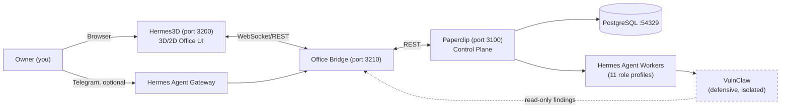

# ALLINONE-AGENT

**Unified Autonomous AI Company & Interactive 3D Virtual Office**

> English (this document) · [Bahasa Indonesia](README.md)

---

## ⚠️ Status of this repository

This repository is the result of consolidating a platform that previously ran on a single personal Windows machine into one product that can (gradually) be reinstalled elsewhere. **Every claim in this document has been independently re-verified** — not copied verbatim from earlier internal reports — and several older claims turned out to be wrong or stale; those are corrected here, not hidden. Read [Known Limitations](#known-limitations) before relying on this for anything important.

**Not yet done**: a full end-to-end installation (`install.ps1` from scratch through to 11 running agents) on any machine, including the original reference machine. What has actually been verified: every individual component builds/compiles/imports cleanly from a clean checkout (see [Testing](#testing)).

---

## 1. Product Overview

ALLINONE-AGENT is not a chatbot, not just an AI coding assistant, and not a single agent. It's a real integration of several components into one "virtual office" with an 11-role AI organization:

- **Hermes Agent** — the execution engine that runs each agent, with an optional Telegram gateway.
- **Paperclip** — control plane: task orchestration, agent management, governance, task queue.
- **VulnClaw** — **defensive-only** security integration (findings analysis, not offensive tooling), strictly isolated.
- **Hermes3D** — a 3D virtual office (Three.js/React Three Fiber) and a 2D (Phaser) office showing all 11 agents' live status.
- **Office Bridge** — the WebSocket/REST bridge synchronizing Paperclip, Hermes, and the office UI.

What makes this different from a generic AI coding assistant: there's a real organization of 11 roles (CEO, CTO, Backend/Frontend Developer, DevOps, QA, Security Lead/Reviewer, Findings Analyst, Remediation Reviewer, Compliance Reporter), each with its own identity, permissions, and workspace — not one generic chat session.

## 2. Main Features

| Feature | Status |
|---|---|
| Task/agent orchestration (Paperclip) | **native** — official upstream, pinned version, unmodified |
| 3D office (Hermes3D) | **custom** — real customization (24-file diff vs. upstream `iamlukethedev/Hermes3D`), builds clean |
| 2D office (Phaser fallback) | **custom** — shares the same state layer as 3D mode (structurally confirmed; not yet proven identical at runtime) |
| 11 agent roles with Wave-1 (active)/Wave-2 (standby) | **native** — verified directly against the provisioning code (`org_provisioner.py`), matches the original claim |
| Telegram integration | **custom**, **optional** — see [Known Limitations](#known-limitations) regarding credential rotation status |
| VulnClaw integration (defensive) | **native**, isolated — scope not extended beyond the existing integration |
| Office Bridge (realtime sync) | **custom**, **partial** — see the Node.js note below |
| Install & setup wizard | **custom**, newly written, **not yet tested end-to-end** (see Testing) |
| Unified CLI `ai-platform` | **native** — real commands: `status health services agents tasks updates logs telegram-cmd emergency-stop resume-wave1 run-maintenance` |
| Daily maintenance (03:00 WIB, offline catch-up) | **custom**, original code (`hermes-autoupdate.ps1`, etc.) vendored as-is |

## 3. Architecture



Trust boundary: VulnClaw is only accessed **read-only** by Office Bridge to surface security findings — never the other way around. Every owner-only endpoint is fail-closed: if `ALLINONE_TELEGRAM_OWNER_ID` isn't set, mutation endpoints reject all callers (proven via an actual smoke-test in Phase 49, not just a design claim).

## 4. System Requirements

Stated honestly, not a fabricated minimum-spec table:

- **OS**: Windows 10 Pro 22H2 x64 (reference machine) or Windows 11. If using Windows 10, confirm your edition/build still receives Microsoft security updates — the installer doesn't verify this automatically.
- **Node.js**: **>= 22.0.0** (hard requirement, not a recommendation). Office Bridge uses `node:sqlite` (a Node 22.5+ builtin) for 3 VulnClaw-findings/analytics adapters; on Node 20 all three fail to load entirely — this is a pre-existing bug in the original platform, not something this consolidation introduced.
- **Git**, **Python 3.x** (stdlib-only for `integration/`, no extra `pip install` needed for the core CLI).
- **.NET SDK 8.0** — only needed to rebuild the Windows launchers (`automation/launchers/*.csproj`); not required to run the platform if you don't rebuild the launchers.
- **RAM**: *no hard minimum enforced.* The installer's preflight only warns informationally below 8GB — this project hasn't been tested on enough varied hardware to assert a universal minimum. The original reference machine is a Pentium G5400 / 8GB RAM / GT 710 2GB — low-end hardware, not a workstation.
- **GPU**: 3D mode uses WebGL (Three.js); 2D mode (Phaser) is available as a fallback for low/no GPU.
- **Disk**: Hermes3D's own build alone takes ~900MB (including `node_modules`/`.next`, which are not distributed in this repo and are rebuilt at install time). Provision significantly more free space than that for dependency installation plus build artifacts.
- **Network**: required during a Fresh install (git clone of 3 upstream repos: Paperclip, VulnClaw, Hermes Agent bridge).

## 5. Quick Start

```powershell
git clone https://github.com/Vistapra/ALLINONE-AGENT.git
cd ALLINONE-AGENT
.\install.ps1 -DryRun
```

Run `-DryRun` first to see the install plan with zero changes made. Once satisfied:

```powershell
.\install.ps1
.\setup.ps1
.\start.ps1
.\health.ps1
```

Or via the batch wrapper (no system-wide PowerShell execution-policy change needed):

```text
install.cmd
```

**Honest caveat**: `install.ps1` has been statically validated (parsing, per-stage logic, and some preflight functions were actually run live against a real machine during Phase 45) but has **never been executed end-to-end** from start to finish on any machine. Run `-DryRun` and read the plan before proceeding.

## 6. Installation — Modes

`install.ps1 -Mode <Auto|Fresh|Adopt|Repair|Dev>` (default `Auto`, self-detecting):

- **Fresh** — the machine has no existing ALLINONE-AGENT/Hermes/Paperclip installation.
- **Adopt** — detects an existing installation (Hermes home, platform scheduled tasks, `ALLINONE_HOME`) and reuses it without duplicating services, databases, or scheduled tasks. This is the realistic path on a machine that has already run the platform.
- **Repair** — fixes dependencies/configuration without deleting live data.
- **Dev** — sets up a development environment.

Installation is idempotent: re-running without `-Force` won't duplicate anything already recorded complete in `runtime\install-state.json`.

## 7. Model Provider Setup

`setup.ps1` prompts for provider, base URL, model name, and API key (stored locally, never committed to this repo). An example configuration that **remains supported but is not the only option and is not an endorsement of correctness**: `provider: custom`, `model: combo/X`, with `CUSTOM_API_KEY` as the credential reference. You're free to configure any other OpenAI-compatible endpoint as long as the base URL and model name are correct. **Live provider-connectivity verification is not yet implemented** in `setup.ps1` — marked `[NOT VERIFIED]` in the code, not claimed to work.

## 8. Telegram Setup (optional)

See [TELEGRAM-SETUP.md](TELEGRAM-SETUP.md) for the full walkthrough: create your own bot via @BotFather, find your numeric owner ID, fill in a local copy of `config/telegram.example.yaml`, run the gateway, test one safe command, test that unauthorized access is rejected. **Telegram integration is fully optional** — the 3D/2D office runs without any bot at all.

The virtual office can be opened with no Telegram setup at all:

```text
http://127.0.0.1:3200/office
```

## 9. Opening the Virtual Office

- **3D**: `http://127.0.0.1:3200/office` (default, requires WebGL).
- **2D**: a Phaser fallback for low-GPU machines — toggle available in the same UI.
- Log in with the owner credential `setup.ps1` generates (a fresh local token, **not** any prior installation's token).

## 10. Example Prompts

On a synthetic/authorized workspace:

- "CEO, draft a 2-week development plan for feature X."
- "CEO, hold a meeting with the Backend Developer and QA Engineer about the database migration plan."
- "Backend Developer, write unit tests for module Y."
- "QA Engineer, verify the changes in PR #123."
- "Security Reviewer, analyze the latest VulnClaw findings and prioritize them."
- "All agents, report your current work status."

## 11. Commands Reference

The real unified CLI (verified directly against the `integration/platform_cli.py` source, not copied from the original brief):

```text
ai-platform status [--json]
ai-platform health [--json]
ai-platform services [--json]
ai-platform agents [--json]
ai-platform tasks [--json]
ai-platform updates [--json]
ai-platform logs [--tail N]
ai-platform telegram-cmd <command> [--args ...] [--caller-id ...] [--message-id ...] [--notify]
ai-platform emergency-stop
ai-platform resume-wave1
ai-platform run-maintenance [--force] [--dry-run]
```

Lifecycle commands: `start.ps1`, `stop.ps1`, `restart.ps1`, `health.ps1`, `update.ps1`, `uninstall.ps1` — see [INSTALLER-REFERENCE.md](INSTALLER-REFERENCE.md) for every script's full flag reference.

## 12. Service Management & Scheduled Tasks

This installer manages **only** 4 scheduled tasks: `PaperclipServer`, `OfficeVirtualCompany`, `PlatformHealthWatchdog`, `PlatformMaintenance`. 4 other tasks belong to the separately-installed upstream `hermes-agent` package (`HermesAutoUpdate`, `Hermes_Gateway`, `HermesPostRebootVerify`, `cua-driver-serve`) — **this installer never touches them**, including `uninstall.ps1` (verified directly from the source, not assumed). See [docs/SERVICE-MANAGEMENT.md](docs/SERVICE-MANAGEMENT.md).

## 13. Maintenance

Default schedule 03:00 Asia/Jakarta, with offline catch-up and active-task deferral — see [docs/MAINTENANCE.md](docs/MAINTENANCE.md). Timezone and schedule are configurable.

## 14. Security & Privacy

- **Credential rotation status on the reference installation (stated as-is, not glossed over)**: the original installation's Telegram bot token and model API key have **not been rotated** since they were previously exposed in chat history (confirmed directly from the platform's own security audit document). A fresh install from this repo **never** copies or reuses those values — it always generates fresh local configuration from `.example` templates.
- This repository has gone through **multiple real rounds of security auditing**, not one automated scan treated as sufficient. Real bugs found and fixed along the way (without naming the actual leaked values):
  - A fail-open owner-authorization check (an unset expected ID could match an unset caller ID) — now fail-closed.
  - Dead placeholder text left over from an earlier automated redaction pass, which had silently disabled a credential-access protection list.
  - A hardcoded default-trust path pointing at one specific private project folder — now configuration-driven, fail-closed, opt-in only.
  - A Python package-naming bug that would have crashed the CLI/health-check/maintenance coordinator on first real use — fixed and verified by actually importing every module.
  - A PowerShell variable-expansion bug that silently disabled a post-update health-heal call.
- **One automated secret scanner alone proved insufficient**: `detect-secrets` (a trusted, widely-used tool) missed real, low-entropy credentials when pointed directly at a folder containing real JWT secrets/API keys. Manual verification remains the primary safety net in this project, not a supplement to automation.
- Hermes3D's bundled 3D/HDRI assets under `apps/hermes3d/public/office-assets/` have **no declared license** — the binary files are not included in this repo (see the README at that location); you'll need to supply your own assets or wait for license clarity.

## 15. Testing

**What has actually been verified** (Phase 49, built from a clean checkout, not claimed):

| Component | Result | Evidence |
|---|---|---|
| Hermes3D (`npm install` + `tsc --noEmit` + `next build`) | **PASS** | 637 packages installed clean, 0 TypeScript errors, production build succeeded, 32 routes generated |
| Python `integration/` | **PASS** | Every module imports cleanly from a clean checkout |
| 3 C# launchers (`dotnet build`, .NET 8) | **PASS** | 0 errors across all three |
| Office Bridge | **PARTIAL** | Missing `package.json` added; smoke-load succeeds up to the port-bind point, but 3 adapters require Node 22+ (see System Requirements) |

**Not yet verified** (scheduled for the next testing phase, not yet done): full end-to-end installation, real 11-agent execution, full 3D/2D multi-agent meeting execution, cross-method functional regression, load testing. Don't assume these features are "tested" just because the source code exists.

## 16. Troubleshooting

| Symptom | Likely cause |
|---|---|
| `office-bridge/server.js` fails to load with a `node:sqlite` error | Node < 22. Upgrade Node to >= 22 (see System Requirements) — not a new bug in this repo. |
| Port already in use during preflight | Expected in `Adopt` mode on an already-running installation; pick a different port in your local config if this is a fresh install. |
| `ai-platform` CLI errors with `ModuleNotFoundError` | Run it from the repo root, or set `PYTHONPATH` to point there — see the note under `integration/`. |
| Owner-only endpoint rejects every request | Working as designed (fail-closed) — set `ALLINONE_TELEGRAM_OWNER_ID` in your local config. |
| `install.ps1` fails at the Node preflight check | Preflight hard-requires Node >= 22.0.0 as of this decision — see System Requirements. |

## 17. Project Structure

```text
ALLINONE-AGENT/
  install.ps1 install.cmd setup.ps1 start.ps1 stop.ps1 restart.ps1 health.ps1 update.ps1 uninstall.ps1
  apps/            hermes3d/ (fully vendored, custom) · office-bridge/ (custom, no upstream)
  integration/      unified Python CLI (platform_cli, org_provisioner, workflow_engine, etc.)
  agents/roles/     11 role definitions + templates, fresh identities generated at install time
  automation/       C# launchers, watchdog, scheduled-task registrar, updater, maintenance
  upstream/         components.lock.json + the Hermes3D patch
  config/           *.example.* templates
  scripts/lib/      shared PowerShell modules (Preflight, InstallState)
  docs/             documentation + redacted development-history archive
  tests/            synthetic fixtures, e2e, unit
```

## 18. Development Guide

- Run `.\install.ps1 -Mode Dev -DryRun` to see the dev-setup plan.
- Build Hermes3D: `cd apps\hermes3d && npm install && npm run typecheck && npm run build`.
- Build a C# launcher: `dotnet build automation\launchers\<Name>.csproj` (needs .NET SDK 8).
- Add a new agent role: duplicate `agents/roles/<role>/` and register it in `integration/org_provisioner.py`.
- Running tests: see [docs/legacy-platform-docs](docs/legacy-platform-docs/) for the historical archive; the active test suite lives under `tests/`.

## 19. Upstream Credits

See [THIRD-PARTY-NOTICES.md](THIRD-PARTY-NOTICES.md) for the full license/copyright text, copied verbatim from each project:

- **Hermes Agent** — npm bridge by wyrtensi (MIT), wrapping the official upstream [NousResearch/hermes-agent](https://github.com/NousResearch/hermes-agent) (MIT).
- **Paperclip** — [paperclipai/paperclip](https://github.com/paperclipai/paperclip) (MIT), pinned reference, unmodified.
- **VulnClaw** — [Netw0rkNoob/VulnClaw](https://github.com/Netw0rkNoob/VulnClaw) (MIT), used purely as a defensive integration, scope not extended.
- **Hermes3D** — [iamlukethedev/Hermes3D](https://github.com/iamlukethedev/Hermes3D) (MIT), fully vendored with local modifications (see `upstream/patches/`).

## 20. License

All four upstream dependencies are MIT-licensed (verified from each project's own actual LICENSE file, not assumed). **This repository's own custom code** (`apps/office-bridge/`, `integration/`, `agents/`, `automation/`, installer scripts) **does not yet have its own LICENSE file** — that's a decision for the repository owner to make; given every upstream dependency is MIT, a consistent MIT license is a reasonable recommendation, but it isn't decided unilaterally here.

## 21. Known Limitations

Written deliberately in full — this is the most important section for trust:

- A full end-to-end installation **has never been run** on any machine.
- Office Bridge cannot load on Node < 22 (see System Requirements) — an inherited bug from the original platform, not new.
- Hermes3D's 3D/HDRI assets have no declared license — not included in this repo.
- This repository's own custom-code license is not yet decided (see License above).
- Full runtime parity between 3D and 2D modes (not just code-structural similarity) has not been proven.
- The claim that "11 agents sit together in one meeting" — the underlying mechanisms (pathfinding, Paperclip task delegation) are real, but evidence of a fully completed, documented multi-agent meeting **was not found**; don't assume this fully works yet.
- The original platform's old test figures ("390/390 PASS") are **self-contradictory** in their own source document (another section of the same document says "387 PASS, 3 NOT_TESTED") — don't republish either figure as fact without reconciling them further.
- `npm audit` on Hermes3D reports 24 dependency vulnerabilities (including 2 critical) — not auto-fixed, needs its own review before production use.
- Credential rotation on the original reference installation has not been performed by its owner (see Security & Privacy) — not something this repo can fix from the inside.
- Live model-provider connectivity verification is not yet implemented in `setup.ps1`.

## 22. Roadmap

- End-to-end installation testing (Fresh/Adopt/Repair) in an isolated environment.
- A decision and implementation for the Office Bridge Node < 22 issue, if needed going forward.
- License clarity for Hermes3D's 3D assets.
- A license decision for this repository's own custom code.
- CI/CD and repository hygiene (see [.github/](.github/) once available).

## 23. Support

Report issues via this repository's GitHub Issues. **Never include tokens, API keys, or any credentials** in an issue report — see [SECURITY.md](SECURITY.md) for how to report security findings privately.
