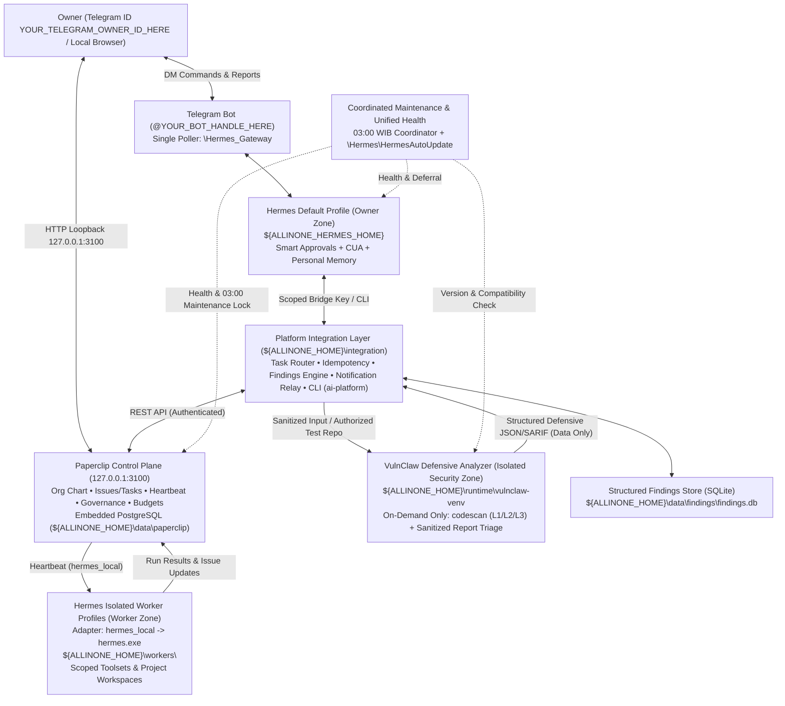

# PHASE 02 — UNIFIED ARCHITECTURE DESIGN

## 1. Objective
Mendesain arsitektur modular dan terukur untuk **UNIFIED AUTONOMOUS AI AGENT PLATFORM** yang menyatukan Paperclip AI (orkestrasi & governance), Hermes Agent (execution engine & Telegram remote command center), dan VulnClaw (evaluasi keamanan defensif terisolasi) tanpa memodifikasi kode inti ketiganya.

## 2. Prerequisites
- `PHASE-00` (`PASS`) dan `PHASE-01` (`PASS`) selesai.
- Direktori kerja utama pada `${ALLINONE_HOME}` terverifikasi memiliki izin tulis pengguna (`7.33 GB` ruang kosong setelah clone source).

## 3. Current Condition
- Hermes Agent beroperasi di `${ALLINONE_USER_HOME}\AppData\Roaming\npm\node_modules\hermes-agent\runtime\hermes-agent` dan `%LOCALAPPDATA%\hermes` dengan Telegram Gateway (`\Hermes_Gateway`), Computer Use (`\cua-driver-serve`), dan Auto-Updater harian pukul `03:00` WIB (`\Hermes\HermesAutoUpdate`).
- Repository sumber resmi `paperclip` dan `vulnclaw` berada di `${ALLINONE_HOME}\paperclip` dan `${ALLINONE_HOME}\vulnclaw`.

## 4. Technical Analysis

### 4.1 Diagram Arsitektur Terpadu


### 4.2 Sumber Kebenaran Tunggal (Single Source of Truth)
| Domain | Pemilik / Single Source of Truth | Lokasi Penyimpanan |
|---|---|---|
| Organisasi, Agent Roster, Project, Task/Issue, Budget, Heartbeat | **Paperclip AI** | Embedded PostgreSQL di `${ALLINONE_HOME}\data\paperclip` |
| Sesi Pribadi Owner, Memori Pribadi, Otentikasi Telegram, Persetujuan GUI/OS | **Hermes Default Profile** | `${ALLINONE_HERMES_HOME}\state.db` & `memories\` |
| State Eksekusi Worker Paperclip | **Hermes Worker Profiles** | `${ALLINONE_HOME}\workers\<role>\hermes_home\state.db` |
| Security Findings Lifecycle & Deduplication | **Findings Integration Store** | `${ALLINONE_HOME}\data\findings\findings.db` (disinkronkan satu arah ke Issue Paperclip) |
| Jadwal Pembaruan Hermes `03:00` WIB | **HermesUpdater Existing** | `${ALLINONE_USER_HOME}\HermesUpdater\state\state.json` |
| Koordinasi Maintenance Lintas-Komponen & Unified Health | **Platform Coordinator & Health Engine** | `${ALLINONE_HOME}\data\maintenance\state.json` |

### 4.3 Rancangan Direktori Aktual
```text
${ALLINONE_HOME}\
├── paperclip\              # Official Git checkout Paperclip (source, skills/paperclip-task-bridge)
├── vulnclaw\               # Official Git checkout VulnClaw v0.4.1
├── runtime\
│   ├── paperclip-app\      # Prebuilt official release paperclipai@2026.1117.0 (Node 26.12.1)
│   ├── vulnclaw-venv\      # Isolated Python venv khusus VulnClaw (uv)
│   └── bin\                # Shims & C# windowless service launcher (ai-platform.cmd, PaperclipServiceLauncher.exe)
├── workers\                # Isolated HERMES_HOME & role instructions per Paperclip agent role
├── workspaces\             # Isolated Git project/worktree workspaces untuk tugas engineering
├── integration\            # Python/Node integration modules (findings engine, task router, coordinator, health)
├── config\                 # Konfigurasi non-rahasia & ACL-protected secret files per komponen
├── data\
│   ├── paperclip\          # PAPERCLIP_HOME (embedded Postgres, instance config, attachments, db backups)
│   ├── vulnclaw\           # VULNCLAW_CONFIG_DIR terisolasi (tanpa kredensial Hermes)
│   ├── findings\           # findings.db & audit trail temuan defensif
│   └── maintenance\        # Maintenance lock & state koordinator 03:00 WIB
├── scripts\                # Startup, self-healing, credential rotation & maintenance scripts
├── tests\                  # Automated test suites & fixtures (Groups A–I)
├── reports\                # Laporan hasil analisis defensif & eksekusi E2E
├── logs\                   # Log terotasi dengan redaksi token otomatis
└── docs\                   # Dokumentasi teknis & laporan Phase Gate (PHASE-00 s/d PHASE-19)
```
*(Seluruh data aplikasi berada di `${ALLINONE_HOME}\data\`, terpisah penuh dari direktori checkout Git `paperclip\` dan `vulnclaw\`).*

### 4.4 Alokasi Port & Keamanan Jaringan
Karena Windows Firewall host berstatus `Enabled = False`, seluruh socket TCP baru **dilarang** menggunakan `0.0.0.0` atau `::`:
- `127.0.0.1:3100` — Paperclip HTTP API + Web Dashboard (`HOST=127.0.0.1`, mode `authenticated`).
- `127.0.0.1:<dynamic/54329>` — Paperclip Embedded PostgreSQL (hanya loopback lokal internal `PAPERCLIP_HOME`).
- `\\.\pipe\cua-driver` — Named pipe existing untuk Hermes Computer Use (`0` port jaringan).
- VulnClaw Web UI (`7788`) **tidak dijalankan secara persisten**; VulnClaw dipanggil *on-demand* via CLI/modul Python lokal tanpa membuka port jaringan.

### 4.5 Kontrak Antarmuka (Integration Contracts) & Anti-Loop Rules
1. **Paperclip -> Hermes (`hermes_local`):** Paperclip memicu `hermes.exe chat -q ...` dengan `env.HERMES_HOME` menunjuk ke `${ALLINONE_HOME}\workers\<role>\hermes_home`, `cwd` menunjuk ke `${ALLINONE_HOME}\workspaces\<project>`, dan `PAPERCLIP_API_KEY` berisi run token sementara berumur pendek.
2. **Hermes -> Paperclip (`Telegram / CLI Task Submission`):** Pesan Telegram dari Owner (`YOUR_TELEGRAM_OWNER_ID_HERE`) tetap diterima tunggal oleh `\Hermes_Gateway`. Untuk tugas kompleks atau perintah `/create_task`, `/tasks`, `/platform_status`, dll., Hermes memanggil CLI `ai-platform` / `paperclip-task-bridge` dengan `idempotency_key` berbasis `(chat_id, message_id)` sehingga pengiriman ulang pesan tidak pernah membuat task ganda.
3. **VulnClaw -> Paperclip (`Security Findings Ingestion`):** Wrapper defensif `ai-platform security` menjalankan `vulnclaw.codescan` atau menelaah laporan JSON/SARIF/Markdown tersanitasi. Seluruh teks laporan diperlakukan murni sebagai literal data JSON (tidak pernah diinterpolasi ke shell atau system prompt eksekusi), disimpan ke `findings.db` dengan deduplikasi fingerprint SHA-256, lalu dibuatkan Issue review/remediasi di Paperclip melalui REST API.
4. **Pencegahan Circular Delegation & Duplicate Scheduler:**
   - Hanya Paperclip yang menjadwalkan heartbeat task organisasi; Hermes `cron` tidak dipakai untuk mem-polling task Paperclip.
   - Worker Hermes memiliki batas kedalaman delegasi (`max_delegation_depth = 2`, `maxTurnsPerRun = 25`) dan tidak memiliki kredensial Telegram sehingga tidak dapat mengirim perintah balik ke bot Telegram seolah-olah sebagai Owner.

### 4.6 Service Lifecycle & Failure Strategy
- **Urutan Startup:** Windows Logon -> Network Check -> `\Hermes_Gateway` + `\cua-driver-serve` + `\Hermes\HermesAutoUpdate` (existing) paralel dengan `\Hermes\PaperclipServer` (Embedded DB -> Paperclip Server `127.0.0.1:3100`) -> `\Hermes\PlatformHealthCheck` (reconciliation & health verification).
- **Penanganan Kegagalan:** Bounded restart dengan exponential backoff, singleton mutex per layanan, deteksi `maintenance.lock` & `update_in_progress` agar watchdog tidak menyalakan ulang proses di tengah pembaruan, serta fail-closed pada autentikasi.

## 5. Implementation Plan
- Membuat seluruh struktur direktori `${ALLINONE_HOME}\*`.
- Mendokumentasikan kontrak antarmuka, port, trust boundaries, dan strategi kegagalan pada `PHASE-02-architecture.md`.

## 6. Actual Execution
- Membuat seluruh subdirektori standar platform pada `${ALLINONE_HOME}\` dan memverifikasi ketersediaan ruang disk (`7.33 GB` bebas).
- Menyusun spesifikasi arsitektur lengkap di `${ALLINONE_HOME}\docs\PHASE-02-architecture.md`.

## 7. Files Created
- Struktur direktori `${ALLINONE_HOME}\{integration,workers,workspaces,config,scripts,tests,docs,reports,logs,runtime,data}`
- `${ALLINONE_HOME}\docs\PHASE-02-architecture.md`

## 8. Files Modified
- `${ALLINONE_HOME}\IMPLEMENTATION-LEDGER.json`
- `${ALLINONE_HOME}\IMPLEMENTATION-LEDGER.md`

## 9. Commands Executed
- Pembuatan direktori `New-Item -ItemType Directory -Force` pada `${ALLINONE_HOME}\*` dan pemeriksaan `Get-PSDrive D`.

## 10. Test Scenarios
- **P02-T1:** Verifikasi seluruh direktori arsitektur terbentuk di luar folder `.git` aplikasi dan memiliki izin tulis penuh bagi akun pengguna.
- **P02-T2:** Verifikasi ketiadaan benturan port pada alokasi loopback `127.0.0.1:3100`.

## 11. Expected Results
- Struktur direktori siap pakai, pemisahan kode vs data terjamin, dan port `3100` bebas.

## 12. Actual Results
- **P02-T1 (`PASS`):** Seluruh 13 direktori tingkat atas dan 4 subdirektori `data\*` berhasil dibuat; sisa ruang `D:` `7.33 GB`.
- **P02-T2 (`PASS`):** Port `127.0.0.1:3100` terkonfirmasi kosong pada audit TCP host.

## 13. Evidence
- Listing direktori `${ALLINONE_HOME}` dan output `D: Free Space after repo clones & skeleton: 7.33 GB`.

## 14. Problems Found
- Tidak ada kendala teknis pada tahap perancangan dan pembuatan struktur direktori.

## 15. Corrective Actions
- Tidak diperlukan.

## 16. Acceptance Criteria
- [x] Architecture diagram tersedia.
- [x] Data flow tersedia.
- [x] Trust boundaries tersedia.
- [x] Directory plan tersedia dan direalisasikan di `${ALLINONE_HOME}`.
- [x] Port allocation tersedia (`127.0.0.1:3100`, loopback-only).
- [x] Service lifecycle tersedia.
- [x] Integration contracts tersedia.
- [x] Failure handling strategy tersedia.

## 17. Final Status
`PASS`
